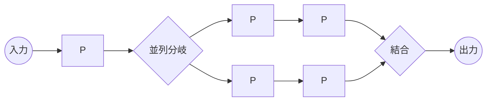
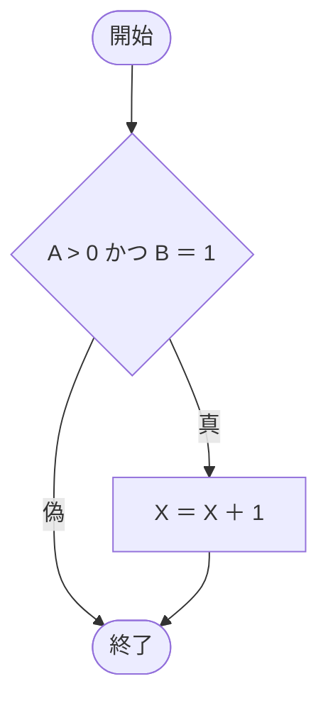

### 問1. システムの信頼性指標 (MTBF/MTTRの定義式)

**【問題】**
システムの稼働モデルが図（稼働と修理のタイムライン）のように表されるとき、システムのMTBFとMTTRを表した式はどれか。ここで、tiはシステムの稼働時間、riはシステムの修理時間を表すものとする。

**【選択肢】**

- ア)$$ MTBF = \frac{1}{n} \sum_{i=1}^{n} r_i, \quad MTTR = \frac{1}{n} \sum_{i=1}^{n} t_i$$
- イ) $$MTBF = \frac{1}{n} \sum_{i=1}^{n} t_i, \quad MTTR = \frac{1}{n} \sum_{i=1}^{n} r_i$$
- ウ)$$ MTBF = \frac{1}{n} \sum_{i=1}^{n} t_i, \quad MTTR = \frac{1}{n} \sum_{i=1}^{n} (t_i + r_i)$$
- エ)$$ MTBF = \frac{1}{n} \sum_{i=1}^{n} (t_i + r_i), \quad MTTR = \frac{1}{n} \sum_{i=1}^{n} r_i$$

**【正解】** **イ**

**【解説】**
MTBF (Mean Time Between Failures：平均故障間隔) はシステムが故障せずに稼働していた時間の平均であるため、稼働時間の総和を稼働回数 $n$ で割った「イ) \frac{1}{n} \sum_{i=1}^{n} t_i」となります。一方、MTTR (Mean Time To Repair：平均修理時間) はシステムが故障して修理にかかった時間の平均であるため、修理時間の総和を修理回数 $n$ で割った「\frac{1}{n} \sum_{i=1}^{n} r_i」となります。

---

### 問2. MTBF & MTTR の改善と稼働率計算 (新出・応用計算)

**【問題】**
あるシステムの今年度のMTBFは3,000時間、MTTRは1,000時間である。翌年度はMTBFについて今年度の20%分の改善、MTTRについて今年度の10%分の改善を図ると、翌年度の稼働率は何%になるか。

**【選択肢】**
- ア) 69%
- イ) 73%
- ウ) 77%
- エ) 80%

**【正解】** **エ**

**【解説】**
1. **改善後のMTBFの計算**:
   今年度のMTBFは3,000時間。20%「改善」する（故障しにくく、間隔が長くなる）ため、新たなMTBFは以下になります。
   $$\text{MTBF}_{\text{new}} = 3,000 \times (1 + 0.20) = 3,600 \text{ 時間}$$
2. **改善後のMTTRの計算**:
   今年度のMTTRは1,000時間。10%「改善」する（修理が早くなり、時間が短くなる）ため、新たなMTTRは以下になります。
   $$\text{MTTR}_{\text{new}} = 1,000 \times (1 - 0.10) = 900 \text{ 時間}$$
3. **翌年度の稼働率（可用性）の計算**:
   稼働率の公式は $\text{Availability} = \frac{\text{MTBF}}{\text{MTBF} + \text{MTTR}}$ です。
   $$\text{稼働率} = \frac{3,600}{3,600 + 900} = \frac{3,600}{4,500} = 0.8 = \mathbf{80\%}$$
よって、正解は **エ** です。

---

### 問3. 並直列システムの稼働率 (システム構成)

**【問題】**
図のような稼働率Pのシステムで構成された多重化システム全体の稼働率を表す式はどれか。ここで、並列の部分は、どちらか一方が稼働していればよいものとする。(左側に直列のP、右側に並列接続された2つのブランチがあり、各ブランチにPが2つ直列に接続されている構成)

**【選択肢】**

- ア) 1 - (1 - P)(1 - P^2)^2
- イ) P{1 - (1 - P)^4}
- ウ) P{1 - (1 - P)^2}^2
- エ) P{1 - (1 - P^2)^2}

**【正解】** **エ**

**【解説】**
1. **並列部分の各ブランチの稼働率**:
   各並列ブランチは「Pが2つ直列に接続」されているため、ブランチ単体の稼働率は $P \times P = P^2$ です。
2. **並列部分全体の稼働率**:
   並列部分は、稼働率 $P^2$ の系統が2本並列に並んでいます。両方が同時に故障する確率は $(1 - P^2)^2$ です。したがって、並列部分の全体の稼働率は $1 - (1 - P^2)^2$ となります。
3. **システム全体の稼働率**:
   左側の直列要素 $P$ と、右側の並列部分が直列に結合しているため、全体の稼働率はそれらの積になります。
   $$\text{全体の稼働率} = P \times (1 - (1 - P^2)^2) = \mathbf{P\{1 - (1 - P^2)^2\}}$$
よって、正解は **エ** です。

---

### 問4. 全加算器の論理演算 (ハードウェア)

**【問題】**
全加算器の入力xに1、yに0、zに1を入力したとき、出力となるc(けた上げ数)、s(和)の値の組合せとして、正しいものはどれか。

**【選択肢】**
- ア) c = 0, s = 0
- イ) c = 0, s = 1
- ウ) c = 1, s = 0
- エ) c = 1, s = 1

**【正解】** **ウ**

**【解説】**
全加算器 (Full Adder) は、2進数1桁の入力 $x, y$ と下位からの桁上げ入力 $z$ を加算し、加算結果を2桁の2進数 $(c, s)$ として出力する回路です。
- 入力：$x = 1, y = 0, z = 1$
- 加算：$1 + 0 + 1 = 2_{10}$
- 2進数表現：$2_{10} = 10_{2}$（2の位が1、1の位が0）
- したがって、上位桁へのキャリー（けた上げ数）は $c = 1$、その桁の和は $s = 0$ となります。

---

### 問5. プリエンプティブ・スケジューリング (OS・タスク管理)

**【問題】**
優先度に基づくプリエンプティブなスケジューリングを行うリアルタイムOSで、二つのタスクA、Bをスケジューリングする。Aの方がBより優先度が高い場合にリアルタイムOSが行う動作のうち、適切なものはどれか。

**【選択肢】**
- ア) Aの実行中にBに起動がかかると、Aを実行可能状態にしてBを実行する。
- イ) Aの実行中にBに起動がかかると、Aを待ち状態にしてBを実行する。
- ウ) Bの実行中にAに起動がかかると、Bを実行可能状態にしてAを実行する。
- エ) Bの実行中にAに起動がかかると、Bを待ち状態にしてAを実行する。

**【正解】** **ウ**

**【解説】**
プリエンプティブ（Preemptive）方式では、OSがCPUの割り当てを管理し、現在実行中のタスクよりも優先度が高いタスクが実行可能（READY）状態になったとき、現在実行中のタスクを中断させて、優先度の高いタスクへCPU使用権を強制的に切り替えます。
- **Aの優先度 ＞ Bの優先度** の場合：
  - Bの実行中に優先度が高いAに起動がかかると、Bは一時中断され、状態は「実行可能状態（READY）」へと遷移し、AにCPUが割り当てられて実行されます（ウが適切）。
  - Aの実行中にBに起動がかかっても、Aの方が優先度が高いため、Aの実行が継続され、Bは実行可能状態で待機します（ア、イは不適切）。
  - Bが中断された際、単にCPUを明け渡すだけで入出力待ちなどではないため、「待ち状態（WAIT）」ではなく「実行可能状態（READY）」に戻ります（エは不適切）。

---

### 問6. OSS(Open Source Software)の特徴 (ライセンス)

**【問題】**
OSS(Open Source Software)の特徴のうち、適切なものはどれか。ここで、OSSはOSI(Open Source Initiative)によるOSD(The Open Source Definition)の定義に基づくものとする。

**【選択肢】**
- ア) OSSはフリーウェアと同様に無償で入手できるが商用システムの開発への利用は禁止されている。
- イ) OSSをパッケージ化したり、自社のソフトウェアを組み合わせたりして、有償で販売することができる。
- ウ) システム開発で利用できるようにソースコードで入手できるが、利用者がある数以上になるとライセンス料が発生する。
- エ) 複製と改良は自由にできるが、改良したソフトウェアを再頒布することはできない。

**【正解】** **イ**

**【解説】**
OSSライセンス（例えばGPL等）では、OSSの再配布の自由が認められており、有償で他者へ販売や再配布を行うことも禁止されていません（イが正解）。
- ア：OSSは商用開発システムであっても、一切制限なく使用できます。
- ウ：利用人数や利用規模によってライセンス料を請求することは「個人やグループ、特定の分野に対する差別の禁止」に反するため許されません。
- エ：改良した（派生）ソフトウェアを、同一のライセンス条件の元で自由に再頒布（再頒布）することが認められています。

---

### 問7. キーロガーの悪用例 (情報セキュリティ)

**【問題】**
キーロガーの悪用例はどれか。

**【選択肢】**
- ア) 通信を行う2者間の経路上に割り込み、両者が交換する情報を収集し、改ざんする。
- イ) ネットバンキング利用時に、利用者が入力したパスワードを収集する。
- ウ) ブラウザでの動画閲覧時に、利用者の意図しない広告を勝手に表示する。
- エ) ブラウザの起動時に、利用者がインストールしていないツールバーを勝手に表示する。

**【正解】** **イ**

**【解説】**
キーロガー（Keylogger）は、PCへのキーボード入力やマウス入力を逐一監視し、それを記録・収集するソフトウェアまたはハードウェアです。利用者が入力したID、ログインパスワード、クレジットカード情報などを盗み出す目的で悪用されます（イが正解）。
- ア：中間者攻撃（Man-in-the-Middle Attack）の説明です。
- ウ：アドウェア（Adware）の説明です。
- エ：ブラウザハイジャッカーや不審なプログラム（PUP）の説明です。

---

### 問8. デジタル署名の利用目的 (情報セキュリティ)

**【問題】**
デジタル署名を通信に利用する主な目的は二つある。一つは、メッセージの発信者を受信者が確認することである。もう一つの目的はどれか。

**【選択肢】**
- ア) 署名が行われた後でメッセージに変更が加えられていないかどうかを、受信者が確認すること。
- イ) 送信の途中でメッセージが不当に解読されていないことを、受信者が確認すること。
- ウ) 発信者のIDを受信者が確認すること。
- エ) 秘密鍵を返信してよいかどうかを受信者が確認すること。

**【正解】** **ア**

**【解説】**
デジタル署名 (Digital Signature) は、公開鍵暗号方式を応用した技術で、受信者側で「①発信元の正当性（送信者のなりすまし防止）」と「②改ざんの有無（送信された内容が途中で改ざんされていないことの確認）」の2点を確認することを主な目的としています（アが正解）。
- イ：暗号化（メッセージの秘匿）が果たす役割です。デジタル署名単体には暗号化の機能はありません（ハッシュ値を暗号化するだけで、本文は平文のまま、または別途暗号化されます）。
- エ：秘密鍵は絶対に他人に渡してはならない鍵であり、返信することはあり得ません。

---

### 問9. フィッシング詐欺の手順 (情報セキュリティ)

**【問題】**
次の手順に示すセキュリティ攻撃はどれか。
「(1) 攻撃者が金融機関の偽のWebサイトを用意する。
(2) 金融機関の社員を装って、偽のWebサイトへ誘導するURLを本文中に含めた電子メールを送信する。
(3) 電子メールの受信者が、その電子メールを信用して本文中のURLをクリックすると、偽のWebサイトに誘導される。
(4) 偽 of Webサイトと気付かずに認証情報を入力すると、その情報が攻撃者に渡る。」

**【選択肢】**
- ア) DDoS攻撃
- イ) フィッシング
- ウ) ボット
- エ) メールヘッダーインジェクション

**【正解】** **イ**

**【解説】**
フィッシング (Phishing) は、実在する金融機関やショッピングサイトなどの偽メールを送り、本物そっくりの偽サイトへ誘導して、ID、パスワード、クレジットカード情報などを入力させ詐取する詐欺手法です（イが正解）。
- ア：DDoS攻撃は、複数のPCからターゲットのサーバーへ大量のトラフィックを送り付けサーバーをダウンさせる攻撃です。
- ウ：ボットは、外部から遠隔操作可能な状態にするウイルスのことです。
- エ：メールヘッダーインジェクションは、フォームへの入力値に改行を含めることで意図しないメールヘッダーを挿入・悪用するウェブ攻撃です。

---

### 問10. NTP (Network Time Protocol) の用途 (ネットワーク)

**【問題】**
NTP(Network Time Protocol)の用途に関する記述として、最も適切なものはどれか。

**【選択肢】**
- ア) クライアントサーバシステムでの業務プログラムの応答時間を正確に測定する。
- イ) タイムサーバを利用して、ネットワーク上の各PCの時刻を合わせる。
- ウ) ファイルサーバに格納されている共用ファイルの更新時刻によって、最新かどうかを判断する。
- エ) メールサーバで電子メールを受信した時刻を比較して、未読の電子メールを転送する。

**【正解】** **イ**

**【解説】**
NTP (Network Time Protocol) は、ネットワーク上のシステム同士やタイムサーバ（時刻サーバ）と同期し、コンピュータの内蔵時計を正しい標準時刻（UTC）に自動的に合わせるためのプロトコルです（イが正解）。

---

### 問11. IPv4サブネットとホストアドレス上限 (ネットワーク計算)

**【問題】**
192.168.0.0/23(サブネットマスク 255.255.254.0)のIPv4ネットワークにおいて、ホストとして使用できるアドレスの個数の上限はどれか。

**【選択肢】**
- ア) 23
- イ) 24
- ウ) 254
- エ) 510

**【正解】** **エ**

**【解説】**
1. **ネットワーク部とホスト部を割り出す**:
   IPv4アドレスは全体で32ビットです。サブネット表記「/23」は先頭の23ビットがネットワークアドレスであることを意味します。
   残りのホストアドレスに使用できるビット数は以下になります。
   $$\text{ホスト部のビット数} = 32 - 23 = 9 \text{ ビット}$$
2. **ホストに割り当て可能なパターンの計算**:
   9ビットで表現できるパターンの総数は、 $2^9 = 512$ 通りです。
3. **予約アドレスを差し引く**:
   サブネット内のアドレスのうち、以下の2つは端末（ホスト）に割り当てることができません。
   - **ネットワークアドレス**: ホスト部がすべて「0」（例: `000000000`）
   - **ブロードキャストアドレス**: ホスト部がすべて「1」（例: `111111111`）
   したがって、ホストに割り当てられる上限数は以下になります。
   $$\text{ホスト数の上限} = 2^9 - 2 = 512 - 2 = \mathbf{510} \text{ 個}$$
よって、正解は **エ** です。

---

### 問12. PKI (公開鍵基盤) における認証局 (CA) の役割 (情報セキュリティ)

**【問題】**
PKI(公開鍵基盤)の認証局が果たす役割はどれか。

**【選択肢】**
- ア) 共通鍵を生成する。
- イ) 公開鍵を利用しデータの暗号化を行う。
- ウ) 失効したデジタル証明書の一覧を発行する。
- エ) データが改ざんされていないことを検証する。

**【正解】** **ウ**

**【解説】**
認証局 (CA：Certificate Authority) は、申請者の身元を保証し、デジタル証明書（電子証明書）を発行・管理する第三者機関です。主な役割として、以下があります。
- デジタル証明書（公開鍵証明書）の新規発行
- 失効した（有効期限内だが無効となった）デジタル証明書の一覧である **CRL (Certificate Revocation List：証明書失効リスト)** やOCSPレスポンスの発行（ウが正解）。

- ア、イ、エ：これらは公開鍵や共通鍵を利用する送信者・受信者の端末側、またはソフトウェアが行う暗号処理であり、認証局が直接実行する役割ではありません。

---

### 問13. ノート型PC盗難時の情報漏えい対策 (情報セキュリティ)

**【問題】**
情報漏えい対策に該当するものはどれか。

**【選択肢】**
- ア) 送信するデータにチェックサムを付加する。
- イ) データが保存されるハードディスクをミラーリングする。
- ウ) データのバックアップ媒体のコピーを遠隔地に保管する。
- エ) ノート型PCのハードディスクの内容を暗号化する。

**【正解】** **エ**

**【解説】**
ノート型PCなどのモバイル端末は盗難・紛失の物理的なリスクが高いため、ハードディスクやSSD全体を暗号化（Drive Encryption）しておくことで、ディスクが抜き取られてもデータを不正に読み出すことができなくなり、情報漏えいを防ぎます（エが正解）。
- ア：データの「完全性（改ざんや通信エラーの検知）」を高める対策です。
- イ、ウ：データの「可用性（データの耐障害性向上、災害復旧対策）」を高める対策です。

---

### 問14. TCP/IP 階層モデルと TCP プロトコル (ネットワーク)

**【問題】**
TCP/IP 階層モデルにおいて、TCPが属する層はどれか。

**【選択肢】**
- ア) アプリケーション層
- イ) インターネット層
- ウ) トランスポート層
- エ) データリンク層

**【正解】** **ウ**

**【解説】**
TCP (Transmission Control Protocol) は、通信の信頼性を確保するための送達管理（3ウェイハンドシェイクなど）を行うコネクション型プロトコルであり、TCP/IP階層モデルにおいては **トランスポート層** に位置します（ウが正解）。
- アプリケーション層：HTTP, SMTP, POP, FTP, DNSなど
- インターネット層：IP, ICMP, ARPなど
- データリンク層（ネットワークインターフェース層）：Ethernet, PPPなど

---

### 問15. 公開鍵暗号方式と RSA 暗号の特徴 (情報セキュリティ)

**【問題】**
公開鍵暗号方式に関する記述のうち、適切なものはどれか。

**【選択肢】**
- ア) AESは、NISTが公募した公開鍵暗号方式である。
- イ) RSAは、素因数分解の計算の困難さを利用した公開鍵暗号方式である。
- ウ) 公開鍵暗号方式に参加する利用者の数が増えると鍵の配送が煩雑になる。 
- エ) 通信文の内容の秘匿に公開鍵暗号方式を使用する場合は、受信者の復号鍵を公開する。

**【正解】** **イ**

**【解説】**
RSA暗号は、巨大な数の「素因数分解の困難さ（素数の乗算は容易だが、その積を素因数分解するには天文学的な計算時間がかかること）」を利用した、最も代表的な公開鍵暗号方式です（イが正解）。
- ア：AES（Advanced Encryption Standard）は、共通鍵暗号方式です。
- ウ：鍵の配送が煩雑（人数が $N$ 人のとき必要な鍵数が $N(N-1)/2$ となり、事前配送が必要）になるのは共通鍵暗号方式の特徴です。公開鍵暗号方式では、各利用者が「自身の秘密鍵と公開鍵のペア（合計2本）」を持つだけでよく、公開鍵は配送の秘密を保つ必要がないため、配送は煩雑になりません。
- エ：通信文の内容を秘匿（暗号化）するには、送信者は「受信者の公開鍵」で暗号化します。受信者は、自分だけが持つ秘密の「復号鍵（秘密鍵）」で復号します。復号鍵（秘密鍵）は絶対に公開してはいけません。

---

### 問16. バックドアの定義 (情報セキュリティ)

**【問題】**
情報セキュリティにおいてバックドアに該当するものはどれか。

**【選択肢】**
- ア) アクセスする際にパスワード認証などの正規の手続が必要なWebサイトに、当該手続を経ないでアクセス可能なURL
- イ) インターネットに公開されているサーバのTCPポートの中からアクティブになっているポートを探して、稼働中のサービスを特定するためのツール
- ウ) ネットワーク上の通信パケットを取得して通信内容を見るために設けられたスイッチのLANポート
- エ) プログラムが確保するメモリ領域に、領域の大きさを超える長さの文字列を入力してあふれさせ、ダウンさせる攻撃

**【正解】** **ア**

**【解説】**
バックドア（Backdoor：裏口）は、一度不正侵入に成功したコンピュータに、いつでも認証を経ずに再侵入できるように攻撃者が設置する裏ルートのことです。サーバー上に不正なCGIを設置してURLから正規のID・パスワード不要でシステムコマンドを実行できるようにした仕掛けなどは、まさにバックドアの典型例です（アが正解）。
- イ：ポートスキャナー（Port Scanner）の説明です。
- ウ：ミラーポート（Mirror Port）の説明です。
- エ：バッファオーバーフロー（Buffer Overflow）攻撃の説明です。

---

### 問17. オブジェクト指向におけるカプセル化 (開発技術)

**【問題】**
オブジェクト指向におけるカプセル化を説明したものはどれか。

**【選択肢】**
- ア) 同じ性質をもつ複数のオブジェクトを抽象化して、整理すること
- イ) 基底クラスの性質を派生クラスに受け継がせること
- ウ) クラス間に共通する性質を抽出し、基底クラスを作ること
- エ) データとそれを操作する手続を一つのオブジェクトにして、データと手続の詳細をオブジェクトの外部から隠蔽すること

**【正解】** **エ**

**【解説】**
カプセル化 (Encapsulation) は、データ（属性・状態）とそれを操作する手続き（メソッド）を一つの「オブジェクト」として一体化し、内部の具体的な処理や詳細なデータを外部から見えなく（情報隠蔽）することです（エが正解）。
- ア：抽象化（Abstraction）やクラス化の説明です。
- イ：インヘリタンス（Inheritance：クラス継承）の説明です。
- ウ：汎化（Generalization）の説明です。

---

### 問18. リバースエンジニアリングの目的 (開発技術)

**【問題】**
ソフトウェアのリバースエンジニアリングの説明はどれか。

**【選択肢】**
- ア) 開発支援ツールなどを用いて、設計情報からソースコードを自動生成する。
- イ) 外部から見たときの振る舞いを変えずに、ソフトウェアの内部構造を変える。
- ウ) 既存のソフトウェアを解析し、その仕様や構造を明らかにする。
- エ) 既存 of ソフトウェアを分析し理解した上で、ソフトウェア全体を新しく構築し直す。

**【正解】** **ウ**

**【解説】**
リバースエンジニアリング (Reverse Engineering) とは、既存の完成したソフトウェア（実行ファイルや製品など）をバイナリ解析、動作確認、コード解析などによって逆方向に分析し、その仕様や構造、設計書、ソースコードなどを明らかに（復元）する手法です（ウが正解）。
- ア：フォワードエンジニアリング（Forward Engineering）の説明です。
- イ：リファクタリング（Refactoring）の説明です。
- エ：リエンジニアリング（Re-engineering）の説明です。

---

### 問19. 回帰テスト (リグレッションテスト) の役割 (開発技術)

**【問題】**
ソフトウェアの保守に当たり、修正や変更がほかの正常箇所に影響していないことを確認するテストはどれか。

**【選択肢】**
- ア) 性能テスト
- イ) 耐久テスト
- ウ) 退行テスト
- エ) 例外処理テスト

**【正解】** **ウ**

**【解説】**
退行テスト（回帰テスト、リグレッションテスト：Regression Test）は、システムを一部修正・変更した際、その変更がこれまでに正常に動作していた他の部分に悪影響（バグの流入やデグレード）を及ぼしていないかを、システム全体または関係部分を再テストすることで検証する工程です（ウが正解）。
- ア：性能テスト（Performance Test）は、要求通りのスループットや応答性能が出ているかを確認します。
- イ：耐久テスト（Stress/Load Test）は、高負荷時に耐えられるかを確認します。
- エ：例外処理テストは、異常値やエラー時に正しくエラーハンドリングされるかを確認します。

---

### 問20. ブラックボックステストのテスト設計 (開発技術)

**【問題】**
ブラックボックステストにおけるテストケースの設計方法として、適切なものはどれか。

**【選択肢】**
- ア) プログラム仕様書の作成又はコーディングが終了した段階で、仕様書やソースリストを参照して、テストケースを設計する。
- イ) プログラムの機能仕様やインタフェースの仕様に基づいて、テストケースを設計する。
- ウ) プログラムの処理手順や内部構造に基づいて、テストケースを設計する。
- エ) プログラムのすべての条件判定で、真と偽をそれぞれ1回以上実行させることを基準に、テストケースを設計する。

**【正解】** **イ**

**【解説】**
ブラックボックステスト (Black-box Testing) は、プログラムの「内部構造（ソースコードの内容）」は見ずに、外部から見たインターフェース（入出力）や機能仕様書（何ができるべきか）に基づいてテストケースを設計します（イが正解）。
- ア、ウ、エ：これらはプログラムの内部ロジックや分岐構造を意識してテストケースを設計する「ホワイトボックステスト（White-box Testing）」の説明です。

---

### 問21. 単体テストの実施ガイドライン (開発技術)

**【問題】**
モジュール単体テストに関する記述として、最も適切なものはどれか。

**【選択肢】**
- ア) 通常はコーディングを行ったプログラマではなく、専任のテスト要員がテストケースを作成し実行する。
- イ) モジュール間インタフェースは、モジュール単体ではテストできないので、単体テストの対象外となる。
- ウ) モジュール設計書は、正しいことが検証済みであるので、テスト結果に問題があるときは、テストケース又はモジュールに誤りがある。
- エ) モジュール設計書を見ながら、原則としてすべてのロジックパスを一度は通るようなテストケースによって、検証を行う。

**【正解】** **エ**

**【解説】**
モジュール単体テスト（Unit Testing）は、プログラムの各最小構成要素（関数やモジュール）が正しく実装されているかを、ホワイトボックステストを用いて確認する工程です。このテストでは、モジュール内部設計書（詳細設計書）に沿って、原則としてすべての処理ルート（ロジックパス）を少なくとも一度は網羅・実行できるテストケースを準備し、検証を行います（エが正解）。
- ア：単体テストは通常、コーディングを行った開発者（プログラマ）自身が実施します。
- イ：モジュール単体でも、そのモジュールの引数、戻り値などのインターフェース仕様が仕様通りに処理されているかは単体テストの範囲です。
- ウ：モジュール設計書（上流工程の成果物）自体に論理的な誤りがある可能性もあるため、「設計書は絶対に正しい」という前提は誤りです。

---

### 問22. ホワイトボックステストの網羅性 (カバレッジ)

**【問題】**
図の構造をもつプログラムに対して、ホワイトボックステストのテストケースを設計するとき、少なくとも実施しなければならないテストケース数が最大になるテスト技法はどれか。 (判定条件: A > 0 かつ B = 1)

**【選択肢】**
- ア) 条件網羅
- イ) 判定条件網羅
- ウ) 複数条件網羅
- エ) 命令網羅

**【正解】** **ウ**

**【解説】**
ホワイトボックステストの網羅基準（カバレッジ基準）の中で、最も厳格で、テストデータ数（ケース数）が最大になるのは **複数条件網羅（Multiple Condition Coverage）** です（ウが正解）。
- **命令網羅（C0）**: すべての命令を少なくとも1回実行する（テストケース数は最小、ここでは1ケースで可能）。
- **判定条件網羅（C1 / 分岐網羅）**: 判定条件全体の真 (True)・偽 (False) を少なくとも1回はテストする（2ケースで可能）。
- **条件網羅（C2）**: 判定内の個々の各単一条件（ここでは「A > 0」と「B = 1」）が真・偽となるケースを網羅する（2ケースで可能）。
- **複数条件網羅**: 個々の各条件の真・偽のすべての可能な組み合わせ（$2^n$、ここでは条件が2つあるので $2^2 = 4$ 通り）をすべて実行するため、テストケース数が最大（4ケース）になります。

---

### 問23. 電子メール規約 MIME (新出・規格)

**【問題】**
インターネットにおける電子メールの規約で、ヘッダフィールドの拡張を行い、テキストだけでなく、音声、画像なども扱えるようにしたものはどれか。

**【選択肢】**
- ア) HTML
- イ) MHS
- ウ) MIME
- エ) SMTP

**【正解】** **ウ**

**【解説】**
MIME (Multipurpose Internet Mail Extensions) は、元来US-ASCIIのテキストメッセージしか送信できなかったSMTPプロトコルの電子メールシステム上で、文字コードを拡張し、添付ファイル（画像、音声、動画、PDFなど）を送受信できるように開発された拡張規格です（ウが正解）。
- ア：HTMLはウェブページを記述するための言語です。
- イ：MHS（Message Handling System）は、OSI等で標準化された電子メール流通システムですが、現在のインターネットメールとは異なります。
- エ：SMTP（Simple Mail Transfer Protocol）は、電子メールを送信・転送するための基本プロトコルですが、標準ではテキストの転送しか行えません。

---

### 問24. ホワイトボックステストの概念 (新出・開発テスト)

**【問題】**
テスト手法の1つであるホワイトボックステストの説明として、適切なものはどれか。

**【選択肢】**
- ア) 下位モジュールから上位モジュールへと順次統合してテストする。
- イ) 上位モジュールから下位モジュールへと順次結合してテストする。
- ウ) モジュールの内部構造に注目してテストする。
- エ) モジュールの内部構造を考慮することなく、仕様書どおり機能が作動するかどうかをテストする。

**【正解】** **ウ**

**【解説】**
ホワイトボックステストは、プログラム（モジュール）の「内部ロジックやアルゴリズム、制御構造、分岐条件（ソースコード）」に直接注目し、そのロジックが正しく網羅されているかをチェックするテスト手法です（ウが正解）。
- ア：ボトムアップテスト（結合テストの手法）の説明です。
- イ：トップダウンテスト（結合テストの手法）の説明です。
- エ：ブラックボックステストの説明です。

---

### 問25. コアコンピタンスの定義 (企業と経営戦略)

**【問題】**
コアコンピタンスを説明したものはどれか。

**【選択肢】**
- ア) 経営活動における基本精神や行動指針
- イ) 事業戦略の遂行によって達成すべき到達目標
- ウ) 自社を取り巻く環境に関するビジネス上の機会と脅威
- エ) 他社との競争優位の源泉となる経営資源及び企業能力

**【正解】** **エ**

**【解説】**
コアコンピタンス (Core Competence) とは、長年の経験や独自技術、高度なノウハウなど、「他社が決して容易に模倣できない、その企業の競争優位の核となる卓越した能力・強み」のことです（エが正解）。
- ア：企業理念（ミッション・バリュー、経営理念）の説明です。
- イ：KGI（重要目標達成指標）や経営目標の説明です。
- ウ：SWOT分析における「機会（Opportunities）」と「脅威（Threats）」、すなわち外部環境要因の説明です。

---

---

## 🔍 Category 2: 演習問題未出題分 (33 Questions)
*出典：第8回演習問題.pdf ～ 第13回演習問題.pdf で期末試験に選ばれなかった問題*

### 📄 第8回演習問題.pdf (未使用3問)

#### [第8回演習問題] 問1. ターンアラウンドタイムの関係式 (性能指標)

**【問題】**
一つのジョブについてのターンアラウンドタイム、CPU時間、入出力時間及び処理待ち時間の4つの時間の関係を表す式はどれか。ここで、ほかのオーバーヘッド時間は考慮しないものとする。

**【選択肢】**
- ア) 処理待ち時間 ＝ CPU時間 ＋ ターンアラウンドタイム ＋ 入出力時間
- イ) 処理待ち時間 ＝ CPU時間 － ターンアラウンドタイム ＋ 入出力時間
- ウ) 処理待ち時間 ＝ ターンアラウンドタイム － CPU時間 － 入出力時間
- エ) 処理待ち時間 ＝ 入出力時間 － CPU時間 － ターンアラウンドタイム

**【正解】** **ウ**

**【解説】**
1. **ターンアラウンドタイム（TAT）の定義**:
   ターンアラウンドタイム（TAT：Turnaround Time）とは、「ジョブがシステムに投入（処理要求開始）されてから、処理結果の出力がすべて完了するまでの全経過時間」を指します。バッチ処理の性能指標として使われます。
2. **時間の内訳**:
   ジョブの全経過時間（TAT）は、以下のようにシステム内でジョブが費やした時間の単純な総和となります。
   $$\text{ターンアラウンドタイム (TAT)} = \text{CPU処理時間} + \text{入出力時間 (I/O時間)} + \text{処理待ち時間}$$
3. **式変形**:
   この関係式を「処理待ち時間」を中心に移項して解くと、全体の時間（TAT）から実際にプログラムが動いていた「CPU時間」と「入出力時間」を引いた残りが待ち時間になるため、以下の式になります。
   $$\text{処理待ち時間} = \text{ターンアラウンドタイム} - \text{CPU時間} - \text{入出力時間}$$
よって、正解は **ウ** です。

---

#### [第8回演習問題] 問3. スプーリングと多重プログラミング計算 (性能指標)

**【問題】**
ある時間帯でのジョブの処理状況を計測したところ、次の通りであった。どのような状況になっているか。
(1)多重度３でジョブを実行する。
(2)ジョブは5分間隔で発生し、実行時間は多重度に依存せず20分である。
(3)各ジョブは実行終了後にスプーリング機能を利用して印刷し、印刷時間は15分である。
(4)プリンターは2台使用する。

**【選択肢】**
- ア) 印刷待ちだけが増加している。
- イ) 実行待ちだけが増加している。
- ウ) 実行待ちと印刷待ちが増加している。
- エ) 実行待ちも印刷待ちも発生していない。

**【正解】** **ウ**

**【解説】**
ジョブの到着ペース（需要）と、システム内の「CPU処理能力」および「プリンター印刷能力」（供給）を比較します。

1. **CPUの処理能力の検証**:
   - ジョブの到着：**5分に1件**
   - ジョブの実行：多重度3（同時に最大3つのジョブを並列実行可能）で、1つの実行に20分かかります。これは、システム全体で「20分ごとに3件のジョブ処理を完了できる」ことを意味します。
   - CPUの処理能力（平均完了時間）は以下になります。
     $$\text{処理能力} = \frac{20 \text{ 分}}{3 \text{ 件}} \approx 6.67 \text{ 分/件}$$
   - **比較**: 到着間隔「5分/件」に対し、CPUの処理能力は「6.67分/件」です。ジョブの到着ペースのほうが処理スピードよりも早いため（$5 < 6.67$）、**実行待ちのジョブは時間とともにどんどん蓄積し、増加します**。

2. **プリンターの処理能力の検証**:
   - 印刷要求の到着：ジョブのCPU処理が完了した段階で、次の印刷（スプーリング領域からプリンターへ）要求が発生します。CPUの平均処理完了スピードが約6.67分/件なので、印刷要求の発生間隔も約**6.67分に1件**となります。
   - プリンターの処理能力：プリンターは2台あり、1件の印刷に15分かかります。これは「15分ごとに2件の印刷を完了できる」ことを意味します。
   - プリンターの処理能力（平均印刷完了時間）は以下になります。
     $$\text{印刷能力} = \frac{15 \text{ 分}}{2 \text{ 件}} = 7.5 \text{ 分/件}$$
   - **比較**: 印刷要求が発生する間隔「約6.67分/件」に対し、プリンターの印刷能力は「7.5分/件」です。印刷要求の発生ペースのほうが印刷スピードよりも早いため（$6.67 < 7.5$）、**印刷待ちのジョブも時間とともにどんどん蓄積し、増加します**。

3. **結論**:
   CPUの実行待ち、およびプリンターの印刷待ちの双方がボトルネックとなっており、時間の経過とともに増加していきます。したがって、正解は **ウ** です。

---

#### [第8回演習問題] 問5. ガーベジコレクション (実記憶管理)

**【問題】**
記憶領域の動的な割り当て及び解放を繰り返すことによって、どこからも利用されない記憶領域が発生することがある。このような記憶領域を再び利用可能にする処理はどれか。

**【選択肢】**
- ア) ガーベジコレクション
- イ) スタック
- ウ) ヒープ
- エ) フラグメンテーション

**【正解】** **ア**

**【解説】**
1. **ガーベジコレクション（Garbage Collection）の定義**:
   プログラムがメモリ上（ヒープ領域など）で動的に領域を確保・解放を繰り返していくと、どこからも参照されなくなった不要なメモリブロック（ゴミ：Garbage）が発生し蓄積します。これらを自動的に回収し、再び空き領域として使用可能な状態に戻すOSや言語処理系の機能を **ガーベジコレクション** （またはガベコレ、実記憶管理におけるコンパクションとほぼ同義）と呼びます（アが正解）。
2. **他の選択肢の解説**:
   - **スタック（Stack）**: 後入先出し（LIFO：Last In First Out）方式のデータ記憶構造です。関数のコールスタック等に使われます。
   - **ヒープ（Heap）**: プログラム実行中に動的に確保・解放が可能なメモリ領域そのもののことです。
   - **フラグメンテーション（Fragmentation）**: メモリの細分化・断片化現象のことであり、空き容量が細かくバラバラに分断されてしまう問題状態を指します。フラグメンテーションを解決するためにガーベジコレクション（コンパクション）を行います。

---

### 📄 第９回演習問題.pdf (未使用7問)

#### [第９回演習問題] 問2. 動的リンキング (言語処理・モジュール結合)

**【問題】**
プログラムを構成するモジュールの結合を，プログラムの実行時に行う方式はどれか。

**【選択肢】**
- ア) インタプリタ
- イ) オーバーレイ
- ウ) 静的リンキング
- エ) 動的リンキング

**【正解】** **エ**

**【解説】**
動的リンキング (Dynamic Linking) は、コンパイルして機械語になったプログラム（実行ファイル）の作成時には結合せず、プログラムの「実行時（ランタイム）」に必要な共通モジュール（WindowsのDLL: Dynamic Link LibraryやLinuxの.soシェアードオブジェクト）を読み込んで動的に結合して使用する方式です。メモリやディスクの容量を節約できます（エが正解）。
- ア：インタプリタはソースプログラムを1行ずつ直接翻訳・実行する処理言語システムです。
- イ：オーバーレイは主記憶に収まらない巨大プログラムを分割し必要な時に必要なブロックだけ上書きしながらロード・実行する手法です。
- ウ：静的リンキング（Static Linking）は、実行ファイル生成時に、プログラム内で呼び出すライブラリをすべて結合してしまう方式です。実行ファイルサイズが大きくなります。

---

#### [第９回演習問題] 問3. OSの提供する API の特徴 (OSの種類と特徴)

**【問題】**
パソコンの OS が提供する機能を利用するための API に関する記述のうち，適切なものはどれか。

**【選択肢】**
- ア) API で呼び出される OS の処理モジュールは，あらかじめそれを利用するプログラムに静的にリンクしておく必要がある。
- イ) OS の API が提供されない周辺機器はユーザープログラムから利用又は制御することはできない。
- ウ) アーキテクチャの異なる CPU 間でも，同じ OS とその API を使用することによって，プログラムの互換性を高め，移植時の工数を削減することが可能である。
- エ) 異なる OS 間でも API は共通であり，API だけを使用したプログラムであれば，再コンパイルだけでほかの OS への移植が可能である。

**【正解】** **ウ**

**【解説】**
同じOSであれば、異なるCPU（例：Intel x86とARMなど）を搭載したシステムであっても、共通のAPI（Application Programming Interface）が提供されます。開発者はAPIを通じてプログラムを書くことで、CPUのハードウェアアーキテクチャに依存しない高い互換性が得られ、プログラムの移植工数が大幅に削減されます（ウが正解）。
- ア：APIは一般に、実行時にOSから呼び出される「動的リンク（Dynamic Link）」で利用されるため、あらかじめ静的リンクしておく必要はありません。
- イ：APIが直接提供されない周辺機器であっても、専用の「デバイスドライバ」を仲介させることでユーザープログラムから利用・制御が可能です。
- エ：WindowsのWin32 APIとUNIX/LinuxのPOSIXのように、OSが異なればAPIは基本的に異なります。異なるOS間でAPIは共通ではありません。

---

#### [第９回演習問題] 問5. 論理回路と論理式の等価性 (排他的論理和：XOR)

**【問題】**
図に示すデジタル回路（A, BがそれぞれNOTゲートに入り、そのNOT AとNOT BがORゲートに入り、その出力と入力AがANDゲートに入り、出力と入力Bが別のANDゲートに入り、最後に両ANDゲートの出力がORゲートに入って出力Xとなる回路）と等価な論理式はどれか。ここで，論理式中の"・"は論理積，"＋"は論理和，\bar{X}はXの否定を表す。

**【選択肢】**
- ア) X = A・B + \bar{A・B}
- イ) X = A・B + \bar{A}・\bar{B}
- ウ) X = A・\bar{B} + \bar{A}・B
- エ) X = (\bar{A} + B)・(A + \bar{B})

**【正解】** **ウ**

**【解説】**
1. **回路の各部分の論理式を追う**:
   - 最初のORゲート：入力が NOT $A$ と NOT $B$（$\bar{A}$ と $\bar{B}$）なので、出力は $\bar{A} + \bar{B}$ です。これはドモルガンの法則により $\bar{A・B}$（NAND）とも表現できます。
   - 上部のANDゲート：入力は $A$ と「最初のORゲートの出力（$\bar{A} + \bar{B}$）」なので、出力は以下になります。
     $$A \cdot (\bar{A} + \bar{B}) = A \cdot \bar{A} + A \cdot \bar{B} = 0 + A \cdot \bar{B} = A \cdot \bar{B}$$
   - 下部のANDゲート：入力は $B$ と「最初のORゲートの出力（$\bar{A} + \bar{B}$）」なので、出力は以下になります。
     $$B \cdot (\bar{A} + \bar{B}) = B \cdot \bar{A} + B \cdot \bar{B} = \bar{A} \cdot B + 0 = \bar{A} \cdot B$$
   - 最後のORゲート（出力X）：2つのANDゲートの出力（$A \cdot \bar{B}$ と $\bar{A} \cdot B$）の論理和をとります。
     $$X = A \cdot \bar{B} + \bar{A} \cdot B$$
2. **結論**:
   この式は **排他的論理和（XOR：Exclusive OR）** の定義そのものであり、ウと等価になります。したがって、正解は **ウ** です。

---

#### [第９回演習問題] 問6. プログラムのビルドプロセス (コンパイル・リンクの流れ)

**【問題】**
図（原始プログラム → コンパイラ → [a] → リンカ → [c] → ローダ、およびリンカに外部から[b]が入力される流れ）はプログラムを翻訳して実行するまでの流れを示したものである。コンパイラ，リンカ，ローダの入出力の組合せとして，適切なものはどれか。

**【選択肢】**
- ア) a: 目的プログラム, \quad b: ライブラリモジュール, \quad c: ロードモジュール
- イ) a: ライブラリモジュール, \quad b: ロードモジュール, \quad c: 目的プログラム
- ウ) a: ロードモジュール, \quad b: 目的プログラム, \quad c: ライブラリモジュール
- エ) a: ロードモジュール, \quad b: ライブラリモジュール, \quad c: 目的プログラム

**【正解】** **ア**

**【解説】**
プログラムが作られて実行されるまでのビルドプロセスは、以下のステップをとります。
1. **コンパイル**: 人間が記述した「原始プログラム（ソースプログラム）」を、コンパイラがCPUが解読可能な機械語に翻訳し、**「[a] 目的プログラム（オブジェクトプログラム）」** を生成します。
2. **リンク（結合）**: リンカ（Linker）が、生成された[a] 目的プログラムに対して、システム側が用意している共通プログラムパーツである **「[b] ライブラリモジュール」** を結合・連結して、実行可能な形式である **「[c] ロードモジュール（実行ファイル）」** を作ります。
3. **ロード（実行）**: 生成された[c] ロードモジュールを、ローダ（Loader）が主記憶（実メモリ）に格納（ロード）して、CPUが順次実行を開始します。
したがって、[a] = 目的プログラム、[b] = ライブラリモジュール、[c] = ロードモジュールである **ア** が正解です。

---

#### [第９回演習問題] 問7. ノン・プリエンプティブ方式の特徴 (OS・タスクスケジューリング)

**【問題】**
ノンプリエンプティブなスケジューリング方式の説明として，適切なものはどれか。

**【選択肢】**
- ア) 新しいタスクが実行可能状態になるたびに，各タスクの残りの実行時間を評価し，その時間が短いものから順に実行する。
- イ) 実行状態としたタスクが決められた時間内に待ち状態に遷移しないときに，そのタスクを中断して実行待ち行列にある次のタスクを実行状態とする。
- ウ) 実行状態としたタスクが自ら待ち状態に遷移するか終了するまで，他のタスクを実行状態とすることができない。
- エ) タスクが実行可能状態になったときに，そのタスクの優先度と，その時，実行状態であるタスクの優先度とを比較して，優先度が高い方のタスクを実行状態とする。

**【正解】** **ウ**

**【解説】**
ノン・プリエンプティブ方式（Non-preemptive）方式は、CPUの管理をOSではなく実行中の各プログラム（タスク）自身に委ねるタスクスケジューリング手法です。
- 現在CPUを使用しているタスクが「自発的に処理をOSに引き渡す（待ち状態に遷移する）」か、「処理を完了して終了する」まで、OS側から強制的にCPUを奪う（タスクを切り替える）ことはできません（ウが正解）。
- メリットとしてタスク制御ロジックが単純になりますが、バグなどによりプログラムが無限ループに陥ってCPUを手放さなくなると、システム全体が完全にフリーズ（ハングアップ）するという大きな問題があります。
- ア、イ、エ：これらはOSが割り込みによって強制的にタスクを切り替える「プリエンプティブ方式」のバリエーション（ラウンドロビンや優先度順など）の説明です。

---

#### [第９回演習問題] 問9. オープンソース統合開発環境 Eclipse (開発支援ツール)

**【問題】**
オープンソースの統合開発環境であって，アプリケーション開発のためのソフトウェア及び支援ツール類をまとめたものはどれか。

**【選択肢】**
- ア) Eclipse
- イ) Perl
- ウ) PHP
- エ) Ruby

**【正解】** **ア**

**【解説】**
Eclipse（エクリプス）は、Javaをはじめ様々なプログラミング言語のソフトウェア開発を支援する、オープンソース（OSS）の代表的な **統合開発環境（IDE：Integrated Development Environment）** です（アが正解）。リッチなGUIエディタ、コンパイラ、デバッガなどが1つにまとまっています。
- イ、ウ、エ：これらはオープンソースの「スクリプトプログラミング言語」の名称です。統合開発環境（IDE）ではありません。

---

#### [第９回演習問題] 問10. カルノー図を用いた論理回路の簡略化 (ハードウェア・論理回路)

**【問題】**
入力A、Bに対して出力 $X$ となる、論理式 $X = A \cdot B + \bar{B}$ を論理回路で表現した図として、等価かつ最も簡略化されたものはどれか。(※カルノー図による簡略化を必要とする問題)

**【選択肢】**
- ア) 入力A, BがNANDに入り、その否定を出力する回路
- イ) 入力Aと、入力BがNOTゲートを通過した値とが、ORゲートに入って出力Xとなる回路（X = A + \bar{B}）
- ウ) 入力AがNOTを通過したものと、入力BとがORゲートに入る回路（X = \bar{A} + B）
- エ) 入力Aと入力BがANDゲートに入り、その出力と入力BのNOTがANDゲートに入る回路

**【正解】** **イ**

**【解説】**
論理式 $X = A \cdot B + \bar{B}$ をカルノー図や代数規則を用いて簡略化します。
1. **代数規則による簡略化**:
   分配の法則を用いて簡略化します。
   $$X = A \cdot B + \bar{B} = (A + \bar{B}) \cdot (B + \bar{B})$$
   ここで、任意の変数 $B$ に対し、自身とその否定の論理和 $B + \bar{B}$ は常に `1` となります。
   $$B + \bar{B} = 1$$
   したがって、式は以下のようになります。
   $$X = (A + \bar{B}) \cdot 1 = \mathbf{A + \bar{B}}$$
2. **カルノー図による検証**:
   入力 $A, B$ に対するカルノー図のセルを埋めると：
   - $B = 0$ (すなわち $\bar{B}$) のとき、 $X = 1$ （Aの真偽に関わらず1になるため、セルは $(A, B) = (0, 0)$ で1、 $(1, 0)$ で1）
   - $A=1, B=1$ のとき、 $A \cdot B = 1$ なので、セルは $(1, 1)$ で1
   カルノー図上で、1のセルは $(0, 0), (1, 0), (1, 1)$ の3箇所です。これらをグループ化してまとめると、以下の2つの項になります。
   - $\bar{B}$ （下部横1列のまとまり）
   - $A$ （右側縦1列のまとまり）
   したがって、簡略化結果は **$X = A + \bar{B}$** となり、これは「入力 $A$ と、入力 $B$ の否定 $\bar{B}$ の論理和」を入力とするORゲート単体で構成可能である「イ」と等価になります。

---

### 📄 第10回演習問題.pdf (未使用6問)

#### [第10回演習問題] 問2. 静止衛星通信の伝送遅延時間 (ネットワーク計算)

**【問題】**
地上から高度約 36,000km の静止軌道衛星を中継して，地上の A 地点と B 地点で通信をする。衛星とA 地点，衛星と B 地点の距離がどちらも 37,500km であり，衛星での中継による遅延を 10 ミリ秒とするとき，A から送信し始めたデータが B に到達するまでの伝送遅延時間は何秒か。ここで，電波の伝搬速度は 3×10^8 m／秒とする。

**【選択肢】**
- ア) 0.13秒
- イ) 0.26秒
- ウ) 0.35秒
- エ) 0.52秒

**【正解】** **イ**

**【解説】**
1. **電波が伝搬する全移動距離の算出**:
   電波は、地上のA地点から静止衛星に上り、そこから地上のB地点へ下ります。それぞれの片道距離が 37,500 km であるため、全移動距離 $D$ は以下になります。
   $$D = 37,500 \text{ km} \times 2 = 75,000 \text{ km} = 75,000,000 \text{ m} = 7.5 \times 10^7 \text{ m}$$
2. **電波の空中伝搬時間の計算**:
   電波の速度 $v$ は $3 \times 10^8$ m/秒です。時間が $t = D / v$ で求められます。
   $$t = \frac{7.5 \times 10^7 \text{ m}}{3 \times 10^8 \text{ m/秒}} = 0.25 \text{ 秒}$$
3. **中継装置内の内部処理遅延の加算**:
   衛星内部での転送処理による遅延が 10 ミリ秒（$0.01$ 秒）存在します。
   $$\text{全伝送遅延時間} = 0.25 \text{ 秒} + 0.01 \text{ 秒} = \mathbf{0.26} \text{ 秒}$$
よって、正解は **イ** です。

---

#### [第10回演習問題] 問3. 情報システム脅威とセキュリティ物理・論理的対策 (情報セキュリティ)

**【問題】**
情報システムヘの脅威とセキュリティ対策の組合せのうち，適切なものはどれか。

**【選択肢】**
- ア) 脅威：誤操作によるデータの論理的な破壊 \quad 対策：ディスクアレイ
- イ) 脅威：地震と火災 \quad 対策：コンピュータ内で複数の仮想化OSを利用したデータの二重化
- ウ) 脅威：伝送中のデータへの不正アクセス \quad 対策：HDLC手順のCRC
- エ) 脅威：メッセージの改ざん \quad 対策：公開鍵暗号方式を応用したデジタル署名

**【正解】** **エ**

**【解説】**
セキュリティの目的と、それに対する対策が論理的に一致しているのは **エ** です。
- **改ざんの検知**には、メッセージに送信者本人の秘密鍵で署名を施す「公開鍵暗号方式を応用したデジタル署名」が極めて有効な対策となります。

- **アの誤り**: 「ディスクアレイ（RAID1やRAID5等）」はハードディスク単体の物理的な故障に対する冗長化（可用性向上）対策であり、ユーザーの「操作ミスによるデータ削除（論理的なデータ破壊）」からは守れません。論理破壊に対処するには、世代管理された別のメディアへの「バックアップ」が有効です。
- **イの誤り**: 同一施設内、または同一マシン上の複数仮想OSで二重化しても、大元の物理ハードウェアが「地震や火災」に遭えば共倒れします。遠隔地のデータセンターへバックアップ（DR/BCP対策）するのが適切な対策です。
- **ウの誤り**: HDLC手順のCRC（巡回冗長検査）は、伝送中の単なる「通信エラー（ノイズによるビット化け）」を検知するハードウェア機能であり、悪意ある第三者による「データの盗聴（不正アクセス）」を防ぐものではありません（暗号化が必要です）。

---

#### [第10回演習問題] 問5. 共通鍵暗号と公開鍵暗号方式の特徴 (情報セキュリティ)

**【問題】**
公開鍵暗号方式に関する記述として、適切なものはどれか。

**【選択肢】**
- ア) AES などの暗号方式がある。
- イ) RSA や楕円(だえん)曲線暗号などの暗号方式がある。
- ウ) 暗号化鍵と復号鍵が同一である。
- エ) 共通鍵の配送が必要である。

**【正解】** **イ**

**【解説】**
公開鍵暗号方式には、代表的なアルゴリズムとして **RSA** や **楕円曲線暗号 (ECC)** などがあります（イが正解）。
- ア、ウ、エ：これらはすべて「共通鍵暗号方式（Symmetric-Key Cryptography）」の特徴です。共通鍵暗号（例: AES）は、暗号化と復号に「全く同一の鍵（共通鍵）」を使用するため、通信相手にその秘密の共通鍵を安全に配送する（鍵配送問題）必要があります。

---

#### [第10回演習問題] 問6. 関係データベースの参照整合性制約 (データベース)

**【問題】**
関係データベース"注文"表の"顧客番号"は"顧客"表の主キー"顧客番号"に対応する外部キーである。このとき、参照の整合性を損なうデータ操作はどれか。ここで、データの並びは、それぞれの表の列の並び（注文：[伝票番号, 顧客番号]、顧客：[顧客番号, 顧客名]）と同順とする。

【テーブル状態】
- "注文"表: [0001, C005], [0002, K001], [0003, C005], [0004, D010]
- "顧客"表: [C005, 福島], [D010, 千葉], [K001, 長野], [L035, 宮崎]

**【選択肢】**
- ア) "顧客"表の行「L035, 宮崎」を削除する。
- イ) "注文"表に行「0005, D010」を追加する。
- ウ) "注文"表に行「0006, F020」を追加する。
- エ) "注文"表の行「0002, K001」を削除する。

**【正解】** **ウ**

**【解説】**
関係データベースにおける **参照整合性制約 (Referential Integrity Constraint)** は、「外部キーとして指定した列の値は、必ず参照される親テーブルの主キー列に存在する値か、NULLでなければならない」というルールです。
- **ウの操作**: "注文"表に、外部キーとなる顧客番号「F020」を含む行を追加しようとしています。しかし、親である"顧客"表の主キー列（顧客番号）には、**「F020」という顧客データは存在していません**。そのため、この追加操作を行うと参照整合性エラーが発生し、システム側で拒否されます（ウが正解、整合性を損なう操作）。

- ア：削除される「L035」は、子テーブルである"注文"表側で1回も外部キーとして参照されていないため、削除しても全く問題ありません。
- イ：追加する顧客番号「D010」は、親である"顧客"表にすでに存在しているため、参照整合性に違反しません。
- エ：子テーブルである"注文"表（参照している側）から行を削除することは、親の整合性に一切影響を与えません。

---

#### [第10回演習問題] 問8. 動画圧縮規格 H.264/MPEG-4 AVC の定義 (マルチメディア)

**【問題】**
H.264/MPEG-4 AVC に関する記述はどれか。

**【選択肢】**
- ア) インターネットで動画や音声データのストリーミング配信を制御するための通信方式
- イ) テレビ会議やテレビ電話で双方向のビデオ配信を制御するための通信方式
- ウ) テレビの電子番組案内で使用される番組内容のメタデータを記述する方式
- エ) ワンセグやインターネットで用いられる動画データの圧縮符号化方式

**【正解】** **エ**

**【解説】**
H.264/MPEG-4 AVC は、非常に高い圧縮効率を持つ動画像（ビデオ）の圧縮符号化規格です。非常にデータ通信量が限られるワンセグ放送やモバイル回線でのインターネット動画配信から、地上デジタル放送、ブルーレイディスクの高ビットレート用途まで、幅広く現在も使用されています（エが正解）。
- ア：RTSP (Real Time Streaming Protocol) などの説明です。
- イ：H.323やSIP (Session Initiation Protocol) などのシグナリングプロトコルの説明です。
- ウ：EPG（Electronic Program Guide）などで用いられるメタデータ（XMLなど）の説明です。

---

#### [第10回演習問題] 問10. 可変長サブネットマスクの定義規則 (ネットワーク)

**【問題】**
IPv4 ネットワークで用いられる可変長サブネットマスクとして，正しいものはどれか。

**【選択肢】**
- ア) 255.255.255.1
- イ) 255.255.255.32
- ウ) 255.255.255.64
- エ) 255.255.255.128

**【正解】** **エ**

**【解説】**
1. **サブネットマスクの基本ルール**:
   IPv4のサブネットマスクは、32ビットのビット列です。このビット列は、ネットワークアドレスを示す部分（ネットワーク部）を「1」の連続、ホストを示す部分（ホスト部）を「0」の連続で表す必要があります。**途中で1と0が交互に混ざったり、0の後に再び1が現れたりすることは絶対にありません**。必ず「先頭から連続した1、その後に連続した0」というビット列になります。
2. **選択肢の2進数変換による検証**:
   最後のオクテット（第4オクテット）に注目して、2進数に展開します。
   - **ア) 1** = `00000001` 2進数（0のあとに1が来ているので×）
   - **イ) 32** = `00100000` 2進数（0のあとに1が来ているので×）
   - **ウ) 64** = `01000000` 2進数（0のあとに1が来ているので×）
   - **エ) 128** = `10000000` 2進数（先頭が「1」で、そのあとすべて「0」が連続しているため、連続性ルールを満たす。正しいサブネットマスク。これはCIDRにおける `/25` を表します）
したがって、正しいものは **エ** です。

---

### 📄 第11回演習問題.pdf (未使用4問)

#### [第11回演習問題] 問2. カプセル化とパケット送出順序 (ネットワーク)

**【問題】**
1 個の TCP パケットをイーサネットに送出したとき，イーサネットフレームに含まれる宛先情報の，送出順序はどれか。

**【選択肢】**
- ア) 宛先 IP アドレス，宛先 MAC アドレス，宛先ポート番号
- イ) 宛先 IP アドレス，宛先ポート番号，宛先 MAC アドレス
- ウ) 宛先 MAC アドレス，宛先 IP アドレス，宛先ポート番号
- エ) 宛先 MAC アドレス，宛先ポート番号，宛先 IP アドレス

**【正解】** **ウ**

**【解説】**
OSI基本参照モデル（またはTCP/IP階層モデル）におけるデータの「カプセル化（Encapsulation）」と物理的な送信順序を紐解きます。

1. **データの流れとヘッダー付加（送信側）**:
   - **アプリケーション層**：データそのものが生成されます。
   - **トランスポート層**：データにポート番号を含む「TCPヘッダー」が付加されます。
   - **インターネット（ネットワーク）層**：それにIPアドレスを含む「IPヘッダー」が付加されます。
   - **データリンク層（イーサネット）**：さらに物理アドレスを含む「MACヘッダー（イーサネットヘッダー）」が付加されて「イーサネットフレーム」が作られます。

2. **物理媒体への送出順序**:
   物理的な通信媒体（LANケーブルなど）へ送出される際は、最も外側のカプセル化ヘッダーである **データリンク層（MACヘッダー：宛先MACアドレス）** から順番に電気信号として送出されていきます。その次に内側のカプセルである **インターネット層（IPヘッダー：宛先IPアドレス）**、最後に最も内側のカプセルである **トランスポート層（TCPヘッダー：宛先ポート番号）**、そして実際のデータ本体、という順番になります。
   - 送出順序：**宛先MACアドレス → 宛先IPアドレス → 宛先ポート番号**
したがって、正解は **ウ** です。

---

#### [第11回演習問題] 問3. LAN アナライザー使用時のリスク管理 (ネットワーク管理・セキュリティ)

**【問題】**
ネットワーク障害の原因を調べるために，ミラーポートを用意して，LAN アナライザーを使用するときに留意することはどれか。

**【選択肢】**
- ア) LAN アナライザーがパケットを破棄してしまうので，測定中は測定対象外のコンピュータの利用を制限しておく必要がある。
- イ) LAN アナライザーにはネットワークを通過するパケットを表示できるので，盗聴などに悪用されないように注意する必要がある。
- ウ) 障害発生に備えて，ネットワーク利用者に LAN アナライザーの保管場所と使用方法を周知しておく必要がある。
- エ) 測定に当たって，LAN ケーブルを一時的に切断する必要があるので，利用者に対して測定日を事前に知らせておく必要がある。

**【正解】** **イ**

**【解説】**
LAN アナライザー（パケットスニッファ）は、ネットワーク上を流れる全てのフレーム・パケットを監視・収集し、プロトコル解析やペイロード表示ができる非常に強力なツールです。
- 管理目的で使用する分にはトラブル解決に役立ちますが、悪意ある第三者の手に渡ったり管理を誤ったりすると、ネットワーク上の「パスワード、個人情報、平文の通信内容」をすべてそのまま表示・収集（パケットキャプチャによる盗聴）できるため、厳重な管理が必要です（イが正解）。

- アの誤り: ミラーポートから流れてきたパケットを「コピー」して見るだけなので、本線ネットワーク上の通常パケットが破棄されることはなく、コンピュータの利用制限も不要です。
- ウの誤り: 悪用されれば甚大な盗聴被害を招く危険なツールであるため、一般の利用者に保管場所や使用方法を周知することは厳禁です。
- エの誤り: スイッチングハブの特定の「ミラーポート（監視ポート）」にLANアナライザー用PCを接続するだけであるため、稼働中の本線LANケーブルを切断する必要はありません。

---

#### [第11回演習問題] 問7. ドライブバイダウンロード攻撃の定義 (情報セキュリティ)

**【問題】**
ドライブバイダウンロード攻撃に該当するものはどれか。

**【選択肢】**
- ア) PC 内のマルウェアを遠隔操作して，PC のハードディスクドライブを丸ごと暗号化する。
- イ) 外部ネットワークからファイアウォールの設定の誤りを突いて侵入し，内部ネットワークにあるサーバのシステムドライブにルートキットを仕掛ける。
- ウ) 公開 Web サイトにおいて，スクリプトを Web ページ中の入力フィールドに入力し，Web サーバがアクセスするデータベース内のデータを不正にダウンロードする。
- エ) 利用者が公開 Web サイトを閲覧したときに，その利用者の意図にかかわらず，PC にマルウェアをダウンロードさせて感染させる。

**【正解】** **エ**

**【解説】**
ドライブバイダウンロード（Drive-by Download）攻撃は、利用者がWebブラウザを介して「単に特定のWebサイトを閲覧しただけ」で、利用者に何らのアクション（同意、ダウンロードボタン押下など）を求めることなく、OSやブラウザ、プラグイン（FlashやJavaなど）の脆弱性を突いて、裏側で自動的にマルウェア（ウイルスなど）をダウンロードさせ、強制的に実行・感染させる攻撃手法です（エが正解）。
- ア：ランサムウェア（Ransomware：身代金要求型ウイルス）の動作説明です。
- イ：不正侵入、およびルートキット（Rootkit：バックドア維持ツール）設置の説明です。
- ウ：SQLインジェクション（SQL Injection）またはクロスサイトスクリプティング（XSS）による不正アクセス・窃取の説明です。

---

#### [第11回演習問題] 問9. トロイの木馬とワームの性質比較 (情報セキュリティ)

**【問題】**
マルウェアについて，トロイの木馬とワームを比較したとき，ワームの特徴はどれか。

**【選択肢】**
- ア) 勝手にファイルを暗号化して正常に読めなくする。
- イ) 単独のプログラムとして不正な動作を行う。
- ウ) 特定の条件になるまで活動をせずに待機する。
- エ) ネットワークやリムーバブルメディアを媒介として自ら感染を広げる。

**【正解】** **エ**

**【解説】**
1. **ワーム（Worm）の明確な特徴**:
   ワームは、他のプログラムに寄生・潜伏（宿主ファイルを必要と）せず、**「単独の実行可能ファイル」として独立して動作**します。そして、最大の決定的な特徴は **「極めて強い自己複製・自己拡散能力」** を持ち、ネットワーク接続やUSBメモリなどのリムーバブルメディアを悪用して、自ら自動的に他のPCへ感染範囲を急拡大させていく点です（エが正解）。
2. **トロイの木馬（Trojan Horse）との違い**:
   トロイの木馬は、画像ファイル、ゲーム、実用ソフトウェアなど「一見すると安全で便利な、無害な正規プログラム」になりすまして利用者に自発的に実行させ、裏側で悪意ある動作（バックドアの開設、情報送信など）を行います。トロイの木馬は、ワームと違って **「自らネットワークを介して自己増殖・自己拡散する能力」は持ちません**。
3. **他の選択肢の解説**:
   - ア：ランサムウェア（Ransomware）の説明です。
   - イ：これはワームとトロイの木馬（どちらも単独動作する）の両方に共通し得ますが、特に宿主ファイルを必要としないワームの特性を言及しています。しかし「ワームの最も強烈なアイデンティティ」はエの自己増殖・自動感染拡散能力です。
   - ウ：トロイの木馬や論理爆弾（Logic Bomb）などの動作説明です。

---

### 📄 第12回演習問題.pdf (未使用4問)

#### [第12回演習問題] 問2. 状態遷移図の役割 (要件定義・分析技法)

**【問題】**
要求の分析・設計時に使用する状態遷移図の説明として，適切なものはどれか。

**【選択肢】**
- ア) 階層構造の形でプログラムの全体構造を記述する。
- イ) 時間の経過や制御信号の変化等の状態を変化させるきっかけと変化に伴って実行する動作を記述する。
- ウ) システムの機能を概要から詳細へと段階的に記述する。
- エ) 処理間のデータの流れをデータフロー，処理，データストア及び外部の四つの記号で記述する。

**【正解】** **イ**

**【解説】**
状態遷移図 (State Transition Diagram) は、システムやオブジェクトが「時間経過」や「外部からの制御信号、入力イベント（トリガー）」によって、状態をどのように移り変わらせるか、またその遷移に伴ってどのような処理（アクション）を実行するかを表現するための図式手法です（イが正解）。イベント駆動型システム（組み込み機器や通信プロトコルなど）の設計に特に多用されます。
- ア：構造図（Structure Chart）やプログラム構造ツリーなどの説明です。
- ウ：段階的詳細化（階層化DFDや機能分割図）などの説明です。
- エ：DFD (Data Flow Diagram：データフロー図) の定義説明です。

---

#### [第12回演習問題] 問5. モジュール強度とモジュール結合度の最適化 (モジュール設計)

**【問題】**
ソフトウェアのモジュール設計において，信頼性，保守性を向上させるためのアプローチとして，望ましいものはどれか。

**【選択肢】**
- ア) モジュール強度を強く，結合度を強くする。
- イ) モジュール強度を強く，結合度を弱くする。
- ウ) モジュール強度を弱く，結合度を強くする。
- エ) モジュール強度を弱く，結合度を弱くする。

**【正解】** **イ**

**【解説】**
ソフトウェアを構成するプログラムブロックである「モジュール」の品質（独立性・保守性・再利用性）を最大化するための鉄則となる設計思想です。
- **モジュール強度（Module Cohesion）**: モジュール内部を構成する要素（処理同士）が、どれだけ密接に一つの目的に向かって結びついているか（関連性の強さ）を示します。**「強く（高い）」**するほど、一つの機能に集中した独立性の高い良いモジュールになります。
- **モジュール結合度（Module Coupling）**: モジュール同士がどれだけ依存・密結合し合っているかを示します。**「弱く（低い）」**するほど、あるモジュールの変更が他のモジュールに波及しなくなり、テストや保守が容易になります。
したがって、望ましい組み合わせは **「モジュール強度を強く，結合度を弱くする」 (イ)** です。

---

#### [第12回演習問題] 問8. デザインレビュー技法 ウォークスルー (開発レビュー)

**【問題】**
設計上の誤りを早期に発見することを目的として，作成者と複数の関係者が設計書をレビューする方法はどれか。

**【選択肢】**
- ア) ウォークスルー
- イ) 机上デバッグ
- ウ) トップダウンテスト
- エ) 並行シミュレーション

**【正解】** **ア**

**【解説】**
ウォークスルー (Walkthrough) は、システム開発の各設計フェーズの終了段階などで、設計書の作成者が主催し、複数の開発関係者がレビューアとして集まって、設計書やソースプログラムを最初から順に人間の頭でシミュレートしながらレビュー・トレースしていく手法です。バグや考慮漏れを早期に発見することを目的としています（アが正解）。ウォークスルーの特徴として「原則、進捗を管理するマネージャーや管理者は同席させず、純粋な技術的エラー発見に特化する」というルールがあります。
- イ：机上デバッグは、プログラマ単独で、または人力で紙に印刷されたコードなどを机の上で追いかけて誤りを探す個人技法です。
- ウ：トップダウンテストは、モジュール結合テストにおいて、最上位モジュールから下位モジュールに向けてモジュールを結合しながらテストする手法です。
- エ：並行シミュレーションは、同一のテストデータを、新旧2つのプログラムに入力して、両者の実行結果を自動比較して妥当性を確認する動的テスト手法です。

---

#### [第12回演習問題] 問10. 静的テスト・静的解析ツールの機能 (テストツール)

**【問題】**
ソフトウェアのテストツールの説明のうち，静的テストを支援する静的解析ツールのものはどれか。

**【選択肢】**
- ア) 指定された条件のテストデータや，プログラムの入力ファイルを自動的に生成する。
- イ) テストの実行結果を基に，命令の網羅率や分岐の網羅率を自動的に計測し，分析する。
- ウ) プログラム中に文法上の誤りや論理的な誤りなどがあるかどうかを，ソースコードを分析して調べる。
- エ) モジュールの呼出し回数や実行時間，実行文の実行回数などの，プログラム実行時の動作特性に関するデータを計測する。

**【正解】** **ウ**

**【解説】**
テストツールは、プログラムを実際に稼働させるか否かで分類されます。
- **静的テスト（静的解析）ツール**: **プログラムを実行せず**に、ソースコードそのものを構文チェック、ルールチェック、コーディング規約違反の検出、デッドコード（到達しないコード）検知などで分析し、バグを早期発見するツールです（ウが正解）。

- ア：テストデータ生成ツール（テストベッド構築ツール）の説明です。
- イ：カバレッジモニター（動的テストツール）の説明です。プログラムを「実行」して網羅率を算出します。
- エ：プロファイラ（動的解析ツール）の説明です。実際にシステムを「動かしながら」実行時間やメモリ使用量を計測します。

---

### 📄 第13回演習問題.pdf (未使用9問)

#### [第13回演習問題] 問1. SWOT分析の目的 (経営戦略)

**【問題】**
経営戦略策定に用いられる SWOT 分析はどれか。

**【選択肢】**
- ア) 競争環境における機会・脅威と事業の強み・弱みを分析する。
- イ) 競争に影響する要因と，他者の動き，自社の動きを分析する。
- ウ) 市場に対するマーケティングツールの最適な組合せを分析する。
- エ) 市場の成長性と占有率の観点から各事業の位置付けを分析する。

**【正解】** **ア**

**【解説】**
SWOT分析は、企業の置かれている経営環境を定性的・客観的に分析し、今後の具体的な事業戦略やロードマップを策定するための経営分析手法です。
- **S**: Strength（強み：内部要因、自社のプラス面）
- **W**: Weakness（弱み・課題：内部要因、自社のマイナス面）
- **O**: Opportunity（機会：外部要因、市場や世の中の変化における追い風）
- **T**: Threat（脅威：外部要因、市場や世の中の変化における向かい風）
これら4つの観点を掛け合わせることで、自社の強みでどう機会を捉え、どう弱みと脅威を回避するかを分析します（アが正解）。
- イ：マクシミン原理などに代表されるゲーム理論や3C分析などの説明です。
- ウ：マーケティングミックス（4P分析：Product, Price, Place, Promotion）の説明です。
- エ：PPM分析（Product Portfolio Management：市場成長率と市場占有率のマトリクス分析）の説明です。

---

#### [第13回演習問題] 問2. SCM (Supply Chain Management) の目的 (経営戦略・物流システム)

**【問題】**
サプライチェーンマネジメントを説明したものはどれか。

**【選択肢】**
- ア) 購買，生産，販売及び物流を結ぶ一連の業務を，企業内，企業間で全体最適の視点から見直し，納期短縮や在庫削減を図る。
- イ) 個人が持っているノウハウや経験などの知的資産を組織全体で共有して，創造的な仕事につなげていく。
- ウ) 社員のスキルや行動特性を把握し，人事戦略の視点から適切な人員配置・評価などのマネジメントを行う。
- エ) 多様なチャネルを通して集められた顧客情報を一元化し，活用することによって，顧客との関係を密接にしていく。

**【正解】** **ア**

**【解説】**
SCM (Supply Chain Management：供給連鎖管理) とは、原材料調達から製品製造、卸、物流、そしてエンドユーザーへの小売・販売に至るすべての商流・物流プロセス（サプライチェーン）を一連のネットワークとして繋ぎ、企業や部門の壁を越えてリアルタイムに情報を相互共有・管理することで、サプライチェーン全体のリードタイム短縮、在庫コスト削減、余剰在庫の解消を目指す「全体最適」の経営手法です（アが正解）。
- イ：ナレッジマネジメント（Knowledge Management）の説明です。
- ウ：人的資源管理（HRM：Human Resource Management）やタレントマネジメントの説明です。
- エ：顧客関係管理（CRM：Customer Relationship Management）の説明です。

---

#### [第13回演習問題] 問3. 著作権法における保護の除外対象 (知的財産権・法務)

**【問題】**
著作権法において，保護の対象とならないものはどれか。

**【選択肢】**
- ア) インターネットで公開されたフリーソフトウェア
- イ) ソフトウェアの操作マニュアル
- ウ) データベース
- エ) プログラム言語や規約

**【正解】** **エ**

**【解説】**
日本の著作権法（第10条3項）では、コンピュータプログラム等に関連する著作物のうち、以下の3つについては「プログラムを記述・表現するための単なる約束事や方法論」であり、誰もが独占することなく自由に使えるべきであるという観点から、**著作権による保護の対象外（除外）**としています。
1. **プログラム言語**（文字その他の記号及びその体系）
2. **規約**（特定のプログラムにおけるプログラム言語の用法の約束事、例：プロトコルなど）
3. **解法**（プログラムにおける指令の組み合わせ方法、例：アルゴリズム）
したがって、プログラム言語や通信プロトコル、アルゴリズムは著作権の対象外となります（エが正解）。
- ア、イ、ウ：これらは「プログラムの著作物（フリーソフトであっても著作権はある）」、「言語の著作物（マニュアル）」、「データベースの著作物（体系的なデータ）」として、それぞれ著作権法によって厳重に保護されます。

---

#### [第13回演習問題] 問4. 個人情報保護法と匿名加工情報のルール (法務)

**【問題】**
個人情報保護委員会"個人情報の保護に関する法律についてのガイドライン"によれば，個人情報に該当しないものはどれか。

**【選択肢】**
- ア) 受付に設置した監視カメラに録画された，本人が判別できる映像データ
- イ) 個人番号の記載がない，社員に交付する源泉徴収票
- ウ) 指紋認証のための指紋データのバックアップデータ
- エ) 匿名加工情報に加工された利用者アンケート情報

**【正解】** **エ**

**【解説】**
個人情報保護法における「個人情報」とは、生存する個人に関する情報であって、特定の個人を識別できるものを指します。これに対し、**匿名加工情報**は「特定の個人を完全に識別できないよう特定の個人情報を適切に加工し、かつ、元の個人情報を復元して特定の個人を再識別することができないようにした情報」です。これは法律上、**個人情報には該当しない**（エが正解）ため、一定のルールの下、本人の明示的な同意を得ることなく第三者への提供やマーケティング等への自由な二次利用（利活用）が認められています。
- ア、イ、ウ：本人がはっきりと判別できる顔映像、社員の収入等が紐づく源泉徴収票（名前等で識別可能）、指紋データ（個人識別符号そのもの）はすべて、法律上厳重に管理される「個人情報」に該当します。

---

#### [第13回演習問題] 問5. EC (Electronic Commerce) の定義 (システム戦略)

**【問題】**
EC(Electronic Commerce)に関する説明として，適切なものはどれか。

**【選択肢】**
- ア) 営業活動に IT を活用して営業効率と品質を高め，売上・利益の大幅な増加や，顧客満足度の向上を目指す方法である。
- イ) 企業がもつ経営資源全体を，総合的かつ一元的に計画・管理し，経営の効率化を図る手法・概念である。
- ウ) 小売店の売上と利益を伸ばすことによって，卸売業者・メーカーが自社との取引拡大につなげるための小売店の経営活動を支援するシステムである。
- エ) 消費者向けや企業間の商取引をインターネットなどの電子的なネットワークを活用して行うことである。

**【正解】** **エ**

**【解説】**
EC (Electronic Commerce：電子商取引) とは、インターネットや専用線などの電子的なネットワークインフラを利用して、企業間（B to B）、企業と消費者間（B to C）、個人間（C to C）などで商品やサービスの決済・注文、商取引を行う仕組み・取引形態そのもののことです（エが正解）。
- ア：SFA（Sales Force Automation：営業活動自動化支援）の説明です。
- イ：ERP（Enterprise Resource Planning：企業資源計画）の説明です。
- ウ：リテールサポート（小売店支援）システムの説明です。

---

#### [第13回演習問題] 問7. 労働者派遣契約のルール (取引法規・派遣法)

**【問題】**
A 社で雇用しているオペレータの Q 氏を，B 社に派遣することになった。労働者派遣法で定められているものはどれか。

**【選択肢】**
- ア) A 社は，Q 氏が A 社を辞めて B 社に雇用されることを禁止できる。
- イ) B 社は A 社に対して，Q 氏を指名して派遣を要請できる。
- ウ) Q 氏の派遣契約期間は，最長 1 年間である。
- エ) Q 氏は，B 社の定められた指揮命令者の下で労働に従事する。

**【正解】** **エ**

**【解説】**
労働者派遣契約において、派遣労働者（Q氏）は、雇用契約は「派遣元企業（A社）」と結んで給与をもらいますが、日々の労働における「実際の指揮命令関係」は **「派遣先企業（B社）」** の指揮命令者との間に発生します（エが正解）。
- アの誤り: 派遣法第33条等により、派遣会社（A社）が、雇用契約終了後に派遣労働者が派遣先（B社）に直接雇用されることを契約等で不当に禁止することは法律上固く禁じられています。
- イの誤り: 派遣先企業（B社）は、派遣契約の際に、履歴書の提出を求めたり特定の個人を指名して要請する「特定目的行為」をすることは法律違反（男女雇用機会均等法や派遣法上の差別防止のため）となります。
- ウの誤り: 1人の派遣労働者が同一の組織（同じ課など）で派遣就労できる最長制限（事業所単位・個人単位の抵触制限）は、原則として「3年」です（1年ではありません）。

---

#### [第13回演習問題] 問8. ホスティングサービスの特徴 (システムソリューション)

**【問題】**
ホスティングサービスの特徴はどれか。

**【選択肢】**
- ア) 運用管理面では，サーバの稼働監視，インシデント対応などを全て利用者が担う。
- イ) サービス事業者が用意したサーバの利用権を利用者に貸し出す。
- ウ) サービス事業者の高性能なサーバを利用者が専有するような使い方には対応しない。
- エ) サービス事業者の施設に利用者が独自のサーバを持ち込み，サーバの選定や組合せは自由に行う。

**【正解】** **イ**

**【解説】**
ホスティングサービス (Hosting Service) は、データセンターを運営するサービス事業者が用意した物理サーバー、または仮想サーバーのシステム機能（利用権）を、有料または無料で顧客にレンタル（貸し出し）するサービスです。一般的なレンタルサーバーがこれに該当します（イが正解）。OSや物理インフラの維持管理は事業者が行ってくれるため、利用者の負担が少ないのがメリットです。
- アの誤り: 物理ハードウェア、および基本的なOSやネットワークインフラの稼働監視・メンテナンスは、すべて事業者側（プロバイダ側）が責任を負います（利用者が担う必要はありません）。
- ウの誤り: サーバーを複数人で共有する共用プランのほか、1台を特定の顧客だけで丸ごと貸し切って独占使用する「専用サーバー（専有）プラン」も多く提供されています。
- エの誤り: データセンターのスペース、電源、回線だけを借りて、利用者が「自分たちで購入した独自のサーバー機を持ち込んで自由に設置・自社運用する」サービスは、ハウジングサービス（コロケーション）の説明です。

---

#### [第13回演習問題] 問9. 貸借対照表 (BS) の定義 (企業会計・財務)

**【問題】**
財務諸表のうち，一定時点における企業の資産，負債及び純資産を表示し，企業の財政状態を明らかにするものはどれか。

**【選択肢】**
- ア) 株主資本等変動計算書
- イ) キャッシュフロー計算書
- ウ) 損益計算書
- エ) 貸借対照表

**【正解】** **エ**

**【解説】**
貸借対照表 (B/S：Balance Sheet) は、企業の決算日など「ある特定の一定時点」における、企業のすべての **資産（財産）、負債（借金）、およびその差額である純資産（自己資本）** を一覧にまとめ、企業の財務状況や財政的な安全性を明らかにするための財務諸表です（エが正解）。左右の合計金額が常に一致することから「バランスシート」とも呼ばれます。
- ア：株主資本等変動計算書は、自己資本（純資産の部）が期中にどのように変動したかの内訳を示す財務諸表です。
- イ：キャッシュフロー計算書（C/F）は、会計期間における「実際の現金（資金）の出入り（インフローとアウトフロー）」を分類表示するものです。
- ウ：損益計算書（P/L）は、企業の会計期間全体（「一定期間」）における「売上（収益）と費用」を対比させて、企業の儲け（経営成績）を明らかにするための財務諸表です。

---

#### [第13回演習問題] 問10. 製造物責任法 (PL法) のプログラムに対する適用限界 (企業法務)

**【問題】**
ソフトウェアやデータに欠陥がある場合に，製造物責任法の対象となるものはどれか。

**【選択肢】**
- ア) ROM 化したソフトウェアを内蔵した組込み機器
- イ) アプリケーションソフトウェアパッケージ
- ウ) 利用者が PC にインストールした OS
- エ) 利用者によってネットワークからダウンロードされたデータ

**【正解】** **ア**

**【解説】**
製造物責任法（PL法：Product Liability Law）は、製造物の欠陥によって消費者の生命や財産などに損害が発生した場合、消費者が製造業者に対して無過失損害賠償を請求できる法律です。
1. **PL法上の「製造物」の定義**:
   法律上、製造物は **「製造又は加工された動産（物理的な実体があるもの）」** と定義されています。したがって、形がない無形物（サービス、不動産、契約、情報など）はPL法の対象外となります。
2. **ソフトウェアやデジタルデータの取り扱い**:
   ソフトウェアプログラム（OSやアプリなど）やダウンロードされたデータは、無体物（物理的実体がない動産ではないもの）であるため、**PL法の直接の対象とはなりません**（イ、ウ、エは対象外）。
3. **組込みソフトの例外ルール**:
   ただし、ROM等に焼き付けられた（または内蔵された）ソフトウェアにプログラム欠陥があり、それによって動産である「ハードウェア製品本体（組込み機器、自動車、家電製品など）」が異常動作を起こして人身事故や火災などを引き起こした場合、**「そのソフトウェアが組み込まれた製品（動産）全体に欠陥がある」** とみなされ、PL法の賠償責任の対象（アが正解）となります。

---

---

## 🔍 Category 3: High-Possibility Sample Questions (7 Questions)
*出典：2025r07_fe_kamoku_a_qs.pdf (最新の科目A公開問題)*

### 📄 2025r07_fe_kamoku_a_qs.pdf (高確率公開問題7問)

#### 問4. 予防保守・遠隔保守と稼働率変化の経年計算 (システム信頼性)

**【問題】**
MTBF は 4,000 時間，MTTR は 1,000 時間の装置がある。今後の 6 年間は，予防保守によって MTBF を前年に比べて毎年 100 時間ずつ改善し，遠隔保守によって MTTR を前年に比べて毎年 100 時間ずつ改善していく計画である。6 年経過後の稼働率は幾らか。

**【選択肢】**
- ア) 0.88
- イ) 0.90
- ウ) 0.92
- エ) 0.94

**【正解】** **ウ**

**【解説】**
1. **改善後のMTBFの計算**:
   初期MTBFは4,000時間です。予防保守により「毎年100時間ずつ改善（長くなる）」するため、6年経過後のMTBFは以下の通り増加します。
   $$\text{MTBF}_{\text{6年後}} = 4,000 + (100 \times 6) = 4,600 \text{ 時間}$$
2. **改善後のMTTRの計算**:
   初期MTTRは1,000時間です。遠隔保守により「毎年100時間ずつ改善（短くなる）」するため、6年経過後のMTTRは以下の通り短縮されます。
   $$\text{MTTR}_{\text{6年後}} = 1,000 - (100 \times 6) = 400 \text{ 時間}$$
3. **6年経過後の稼働率（可用性）の計算**:
   $$\text{稼働率} = \frac{\text{MTBF}_{\text{6年後}}}{\text{MTBF}_{\text{6年後}} + \text{MTTR}_{\text{6年後}}} = \frac{4,600}{4,600 + 400} = \frac{4,600}{5,000} = \mathbf{0.92}$$
よって、正解は **ウ** です。

---

#### 問7. 回線利用率の計算 (ネットワーク伝送計算)

**【問題】**
1G バイトの動画データを 40M ビット／秒の回線を使用してダウンロードしたところ，5 分掛かった。このときの回線利用率はおよそ何％か。ここで，ダウンロード時には動画データに 20％の制御情報が付加されるものとする。

**【選択肢】**
- ア) 10%
- イ) 53%
- ウ) 67%
- エ) 80%

**【正解】** **エ**

**【解説】**
1. **実際に伝送されたデータ量（バイト）の計算**:
   動画データサイズは 1 GB ($10^9$ バイト) です。これに 20% の制御オーバーヘッドが付加されるため、実際に流れる全データ量は $1.20$ 倍になります。
   $$\text{送信データ量} = 1 \text{ GB} \times 1.20 = 1.2 \text{ GB} = 1.2 \times 10^9 \text{ バイト}$$
2. **データ量をビット（bit）に変換**:
   1バイト = 8ビットです。
   $$\text{送信データ量 (bit)} = 1.2 \times 10^9 \times 8 = 9.6 \times 10^9 \text{ ビット}$$
3. **実際のデータ伝送速度の計算**:
   ダウンロードに5分（300秒）かかりました。
   $$\text{実効速度 (bps)} = \frac{9.6 \times 10^9 \text{ ビット}}{300 \text{ 秒}} = 3.2 \times 10^7 \text{ bps} = 32 \text{ Mbps}$$
4. **回線利用率の計算**:
   回線の理論速度（最大速度）は 40 Mbps です。
   $$\text{回線利用率} = \frac{\text{実際の伝送速度}}{\text{理論上の回線速度}} = \frac{32 \text{ Mbps}}{40 \text{ Mbps}} = 0.8 = \mathbf{80\%}$$
よって、正解は **エ** です。

---

#### 問8. HTTPS 独自のセキュリティ上の利点 (通信プロトコル)

**【問題】**
HTTP と HTTPS を比較した場合において，HTTPS だけがもつ特徴を示したものはどれか。

**【選択肢】**
- ア) cookie に保存されている情報を用いたセッション管理が可能である。
- イ) ID とパスワードによって利用者の認証を行うことが可能である。
- ウ) Web ブラウザでキャッシュさせることによって通信量を減らすことが可能である。
- エ) 通信相手先サーバをサーバ証明書によって確認することが可能である。

**【正解】** **エ**

**【解説】**
HTTPS (Hypertext Transfer Protocol Secure) は、SSL/TLSを用いて暗号化やサーバー認証を行うプロトコルです。
- HTTPS通信の接続時に、サーバーから送信される **「サーバー証明書」** をブラウザ側で検証（信頼できる認証局による署名であるか等の確認）することにより、「通信相手先が本物のサーバーであるか（なりすましされていないか）」を確認できる機能がHTTPS最大の特徴であり独自の利点です（エが正解）。
- ア、イ、ウ：これらはセキュリティで保護されていない通常の「HTTP」であっても、Cookieの使用、ベーシック認証/フォーム認証、ブラウザキャッシュなどを通じて全く同様に実現可能な一般的なWeb技術仕様です。HTTPSだけの独自機能ではありません。

---

#### 問9. 暗号の危殆化（きたいか）の定義 (暗号技術)

**【問題】**
暗号の危殆化（きたいか）に該当するものはどれか。

**【選択肢】**
- ア) ある CA でデジタル証明書の署名に使っている公開鍵のデジタル証明書の有効期限が切れた。
- イ) ある暗号アルゴリズムの秘密鍵が不正アクセスによって漏えいした。
- ウ) あるハッシュ関数においてハッシュ値が同じになるデータの組みを現実的な時間内で発見する方法が見つかった。
- エ) あるランサムウェアの一種で暗号化されたファイルの復号鍵が公開された。

**【正解】** **ウ**

**【解説】**
「暗号の危殆化（きたいか）」とは、暗号アルゴリズムそのものの理論的な欠陥や、コンピュータの計算速度の劇的な向上などによって、「暗号化やハッシュ関数の数学的な安全性・強度が低下・喪失すること」を意味します。
- ハッシュ関数において、異なる入力データから同一のハッシュ値が生成されてしまう（ハッシュ衝突）ような入力データのペアを、総当たりでなく現実的な時間内で逆算・発見できる数学的なアルゴリズムが発見された（ウが正解）場合、ハッシュ関数の安全性は破綻し、「危殆化」したことになります。
- ア：単なるデジタル証明書の「有効期限切れ（時間経過）」であり、アルゴリズムの危殆化とは関係ありません。
- イ：秘密鍵の「鍵管理の不備（情報漏えい）」に該当し、アルゴリズム自体の欠陥（危殆化）ではありません。
- エ：マルウェア（ランサムウェア）作者の復号鍵開示やフォレンジック分析結果であり、一般の暗号理論の危殆化とは直接結びつきません。

---

#### 問12. オブジェクト指向 多相性 (Polymorphism) (開発技術)

**【問題】**
オブジェクト指向プログラミングの特徴のうち，異なるクラスのオブジェクトを同一のインタフェースで操作したときに，操作対象クラスに応じた異なる動作を可能にすることを何と呼ぶか。

**【選択肢】**
- ア) 委譲
- イ) 継承
- ウ) コンポジション
- エ) 多相性

**【正解】** **エ**

**【解説】**
多相性 (Polymorphism：ポリモーフィズム) は、オブジェクト指向設計の極めて重要な特徴です。例えば「draw()」という全く同じ呼び出し用のメッセージ（同一インターフェース）を、「Circle（円）オブジェクト」と「Triangle（三角形）オブジェクト」へ別々に送信した際、各々のオブジェクトが自分自身のクラスに定義されたロジックに沿って、それぞれ全く「異なる描画動作」を自発的に実行する性質を指します（エが正解）。これにより呼び出し側のコードを大幅に共通化・簡潔に保てます。
- ア：委譲（Delegation）は、ある処理の一部を他のオブジェクトへ転送・依頼して代行させるプログラムパターンです。
- イ：継承（Inheritance）は、共通する性質を持つ親クラスの定義（フィールド、メソッド）を子クラスへそのまま引き継がせることです。
- ウ：コンポジション（Composition）は、オブジェクトの内部構造に、他のクラスのインスタンスを包含することで関係性を持たせる設計手法です。

---

#### 問16. マーケットバスケット分析の定義 (データマイニング)

**【問題】**
データマイニングの手法の一つであって，POS などの蓄積データから“一緒に買われる商品”の組合せを発見する分析手法はどれか。

**【選択肢】**
- ア) 3C 分析
- イ) ABC 分析
- ウ) コンジョイント分析
- エ) マーケットバスケット分析

**【正解】** **エ**

**【解説】**
マーケットバスケット分析 (Market Basket Analysis) は、POSシステムに蓄積された顧客の購買トランザクションデータをデータマイニングによって解析し、「顧客がレジに持っていく買い物かご（バスケット）の中で、どの商品とどの商品が同時に一緒に購入されやすいか」というアソシエーションルール（相関ルール）を統計的に発見する手法です（エが正解）。「おむつを買う顧客は、ビールを一緒に買う確率が高い」という実例が有名です。
- ア：3C分析はマーケティング分析のフレームワークであり、Customer (顧客)、Competitor (競合)、Company (自社)の3つのマクロ視点から戦略を立てます。
- イ：ABC分析は、売上高や在庫価値の大きい順に商品をA・B・Cの3グループに分類し、重点管理（パレートの法則を応用）を行う手法です。
- ウ：コンジョイント分析は、顧客が商品を購入する際「価格、機能、デザイン」などの様々な構成要素のどれを最重視しているかの選好度を統計的に推定する手法です。

---

#### 問18. ロングテールビジネスを成功させる施策 (経営戦略・EC)

**【問題】**
物販事業において，ロングテールをビジネスとして成功させるために必要な施策はどれか。

**【選択肢】**
- ア) 多くの有名ブランド店が出店するショッピングモールの構築
- イ) 交通の利便性が高い地域に対する，生活必需品を広く浅く取りそろえた出店計画
- ウ) 店舗で購入した商品を近隣地域に無償で配送するサービスの実施
- エ) 豊富なしなぞろえと，在庫コストや配送費用を抑えるための大規模な物流センタの構築や活用

**【正解】** **エ**

**【解説】**
1. **ロングテール（The Long Tail）ビジネスモデルの概念**:
   インターネット販売（EC）等において、売れ筋上位20%の主力商品（ヘッド）だけでなく、年間で数個しか売れないような無数のニッチな死に筋商品（テール：恐竜の長い尾に似ていることから命名）を数多く幅広く品揃えし、ネット上でいつでも購入できるようにすることで、それらの「塵も積もれば山となる」ニッチ商品の売上合計が、主力商品の合計売上を上回るビジネスモデルです。
2. **成功のための必要条件**:
   ロングテールを成立させるには、物理的な実店舗と違って「陳列スペースが無限に近く、コストがほぼゼロ」であること、そして「超多品種かつ少数の在庫を極めて低コストで保管・ピッキング・全国配送できる効率的なサプライチェーンインフラ」が不可欠となります。したがって、**「豊富な品ぞろえと、在庫コストや配送費用を極小化するための大規模かつ自動化された物流センターを構築・活用する（エ）」**ことが決定的な成功条件となります（エが正解）。
- ア、イ、ウ：これらは物理的な「実店舗（リアル店舗）」やブランド訴求などを前提とした古典的な販売戦略であり、ニッチ商品群の積算売上を狙うロングテール戦略の核心とは一致しません。

---

