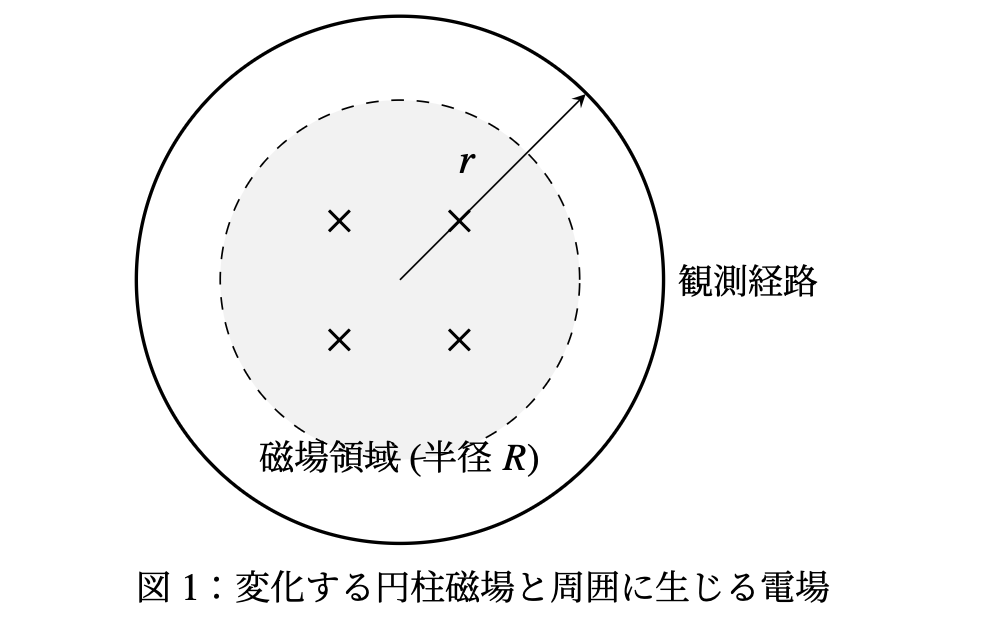
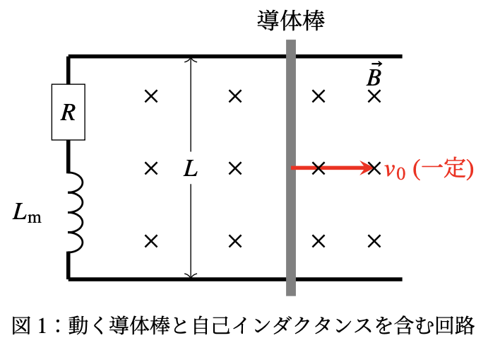
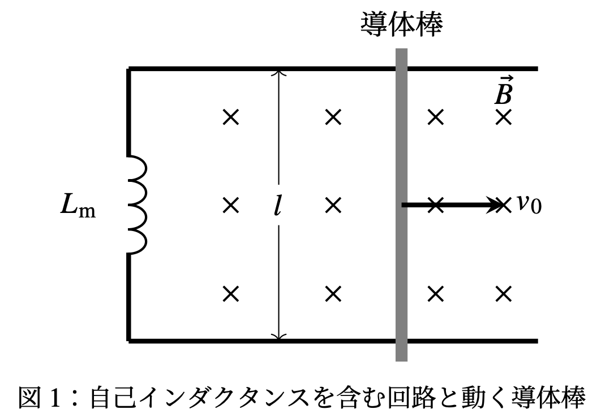
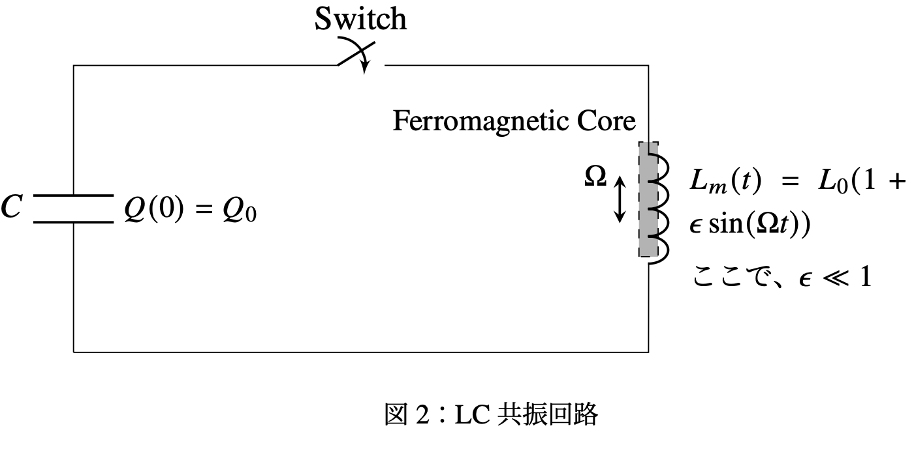
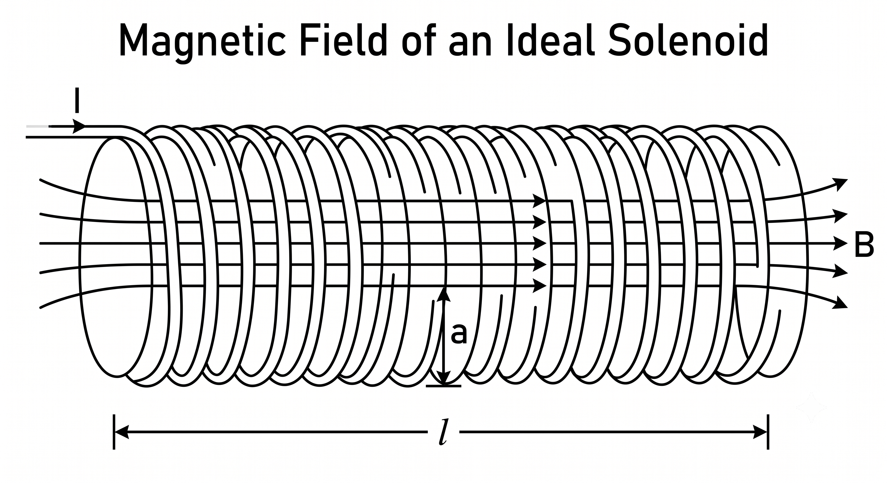

### 【問題1】磁束の時間変化とファラデーの法則
巻き数が $N$ ターンの密に巻かれた平らなコイルがあり、その開口部の面積は $S$ である。時刻 $t=0$ における磁束密度の大きさを $B_0$ とし、磁束密度が一定の割合 $\alpha$ で増加している（すなわち、$B(t) = B_0 + \alpha t$）。回路の全電気抵抗を $R$ とするとき、以下の問いに答えよ。

**1. 時刻 $t$ において、コイルの1ターンを貫く磁束 $\Phi(t)$ を文字式で求めよ。**
*   **Formula:** 
    $\Phi(t) = B(t) \cdot S$
*   **Solution:** 
    $\Phi(t) = (B_0 + \alpha t)S$

**2. ファラデーの電磁誘導の法則を用いて、コイル全体に生じる誘導起電力の大きさ $V$ を求めよ。**
*   **Formula:** 
    $V = \left| -N \frac{d\Phi}{dt} \right|$
*   **Step:** 
    $V = N \cdot \frac{d}{dt} \{ (B_0 + \alpha t)S \}$
*   **Solution:** 
    $V = N S \alpha$

**3. コイルを流れる誘導電流の大きさ $I$ を求めよ。**
*   **Formula:** 
    $I = \frac{V}{R}$
*   **Solution:** 
    $I = \frac{N S \alpha}{R}$

---

### 【問題2】中心対称性をもつ時間変動磁場による誘起電場
空間の半径 $R$ の円柱領域にのみ、軸方向に一様な磁場が存在しており、その磁束密度の大きさ $B(t)$ が時間とともに変化している。円柱の軸を中心とする半径 $r$ の同心円上の円形経路を考える。

**1. ファラデーの法則の積分形 $\oint \mathbf{E} \cdot d\mathbf{r} = -\frac{d\Phi}{dt}$ を用いて、円柱の内側の領域（$r \le R$）において誘起される電場の強さ $E(r)$ を求めよ。**
*   **Step 1 (Line Integral):** 
    $\oint \mathbf{E} \cdot d\mathbf{r} = E(r) \cdot 2\pi r$
*   **Step 2 (Magnetic Flux):** 
    $\Phi = B(t) \cdot \pi r^2$
*   **Step 3 (Faraday's Law):** 
    $2\pi r E(r) = - \frac{d}{dt}(B(t) \cdot \pi r^2) = -\pi r^2 \frac{dB}{dt}$
*   **Solution (Magnitude):** 
    $E(r) = \frac{r}{2} \left| \frac{dB}{dt} \right|$

**2. 円柱の外側の領域（$r > R$）において誘起される電場の強さ $E(r)$ を求めよ。**
*   **Step 1 (Line Integral):** 
    $\oint \mathbf{E} \cdot d\mathbf{r} = E(r) \cdot 2\pi r$
*   **Step 2 (Magnetic Flux - capped at radius R):** 
    $\Phi = B(t) \cdot \pi R^2$
*   **Step 3 (Faraday's Law):** 
    $2\pi r E(r) = - \frac{d}{dt}(B(t) \cdot \pi R^2) = -\pi R^2 \frac{dB}{dt}$
*   **Solution (Magnitude):** 
    $E(r) = \frac{R^2}{2r} \left| \frac{dB}{dt} \right|$

---

### 【問題3】傾いたレール上の導体棒の終端速度
鉛直上向きに一様な磁束密度 $B$ の磁場が空間に満たされている。水平面から角度 $\theta$ 傾いた、間隔 $l$ の2本の平行なレールを設置し、上端を抵抗 $R$ で結んだ。質量 $m$ の導体棒をレールに沿って滑り降りさせる。重力加速度の大きさを $g$ とする。

**1. 導体棒が速度 $v$ で下向きに運動しているとき、導体棒に発生する誘導起電力の大きさ $V$ を求めよ。**
*   **Step 1 (Perpendicular Velocity):** 
    $v_{\perp} = v \cos\theta$
*   **Solution:** 
    $V = B l v_{\perp} = B l v \cos\theta$

**2. 導体棒が受けるアンペール力と重力の斜面方向成分がつり合うときの、一定の速度（終端速度）$v_f$ を求めよ。**
*   **Step 1 (Current):** 
    $I = \frac{V}{R} = \frac{B l v_f \cos\theta}{R}$
*   **Step 2 (Ampere Force - Horizontal):** 
    $F_A = I B l = \frac{B^2 l^2 v_f \cos\theta}{R}$
*   **Step 3 (Force Balance along Incline):** 
    $mg \sin\theta = F_A \cos\theta$
*   **Step 4 (Substitute $F_A$):** 
    $mg \sin\theta = \left( \frac{B^2 l^2 v_f \cos\theta}{R} \right) \cos\theta = \frac{B^2 l^2 v_f \cos^2\theta}{R}$
*   **Solution (Solve for $v_f$):** 
    $v_f = \frac{mg R \sin\theta}{B^2 l^2 \cos^2\theta}$

### 【Part 1: Exercise 11 (Exam Version - No Explanations)】

#### 【問題1】動く導体棒を含むRL回路の過渡現象 (RL Circuit Transient Phenomenon)
時間的に変化しない一様な磁束密度 $B$ の磁場が、紙面の表から裏に向かって垂直に貫いている。この磁場中に、間隔 $l$ の十分長い2本の平行な導電性レールを水平に固定し、左端に自己インダクタンス $L$ のコイルと抵抗値 $R$ の抵抗器を直列に接続してU字型の回路を構成する。導体棒をレール上で一定の速度 $v_0$ で右向きに引き続ける。時刻 $t=0$ に回路を流れる電流が $I(0)=0$ であったとして、以下の問いに答えよ。

**1. 導体棒の運動によって回路に生じる動的な誘導起電力の大きさ $V_0$ を求めよ。**
*   **Formula:** $V_0 = B \cdot l \cdot v_0$
*   **Solution:** $V_0 = B l v_0$

**2. コイルの自己インダクタンスによる逆起電力を考慮して、回路に関するキルヒホッフの第2法則（電圧方程式）を立てよ。**
*   **Step 1 (Inductor Back EMF):** $V_L = -L \frac{dI}{dt}$
*   **Step 2 (Kirchhoff's Voltage Law):** $V_0 + V_L = RI \Rightarrow V_0 - L \frac{dI}{dt} = RI$
*   **Solution:** $L \frac{dI}{dt} + RI = B l v_0$

**3. 上記の微分方程式を初期条件 $I(0)=0$ のもとで解き、電流 $I(t)$ を求めよ。**
*   **Step 1 (Rearrange DE):** $\frac{dI}{dt} = -\frac{R}{L} \left( I - \frac{B l v_0}{R} \right)$
*   **Step 2 (Separation of Variables):** $\int \frac{1}{I - \frac{B l v_0}{R}} dI = \int -\frac{R}{L} dt$
*   **Step 3 (Integrate):** $\ln \left| I - \frac{B l v_0}{R} \right| = -\frac{R}{L}t + C_1$
*   **Step 4 (Solve for I):** $I(t) = \frac{B l v_0}{R} + A e^{-\frac{R}{L}t}$
*   **Step 5 (Apply Initial Condition $I(0)=0$):** $0 = \frac{B l v_0}{R} + A e^0 \Rightarrow A = -\frac{B l v_0}{R}$
*   **Solution:** $I(t) = \frac{B l v_0}{R} \left( 1 - e^{-\frac{R}{L}t} \right)$

---

#### 【問題2】遮断回路における自己インダクタンス (Circuit Disconnection)
自己インダクタンス $L$ のコイル、抵抗値 $R$ の抵抗器、および起電力 $E$ の直流電源が直列に接続された回路がある。定常電流 $I_0 = E/R$ が流れている状態から、時刻 $t=0$ にスイッチを急速に開いた。スイッチを引き離す過程の極めて短い時間において、空気隙間の電気抵抗を $R_{gap}(t)$ とする。

**1. スイッチを切り離す過程において、回路の電流 $I(t)$ に関する微分方程式を示せ。**
*   **Step 1 (Total Resistance):** $R_{total} = R + R_{gap}(t)$
*   **Step 2 (Kirchhoff's Law with Back EMF):** $E - L \frac{dI}{dt} = R_{total} \cdot I(t)$
*   **Solution:** $L \frac{dI}{dt} + (R + R_{gap}(t))I(t) = E$

---

### 【Part 1: Exercise 12 (Exam Version - No Explanations)】

#### 【問題1】磁場のエネルギーを用いたアンペール力の導出 [1-3]
十分長い平行なレール（間隔 $l$）の間を、回路に一定の電流 $I$ が流れた状態を維持したまま、導体棒を外力によって速度 $v$ で右向きに距離 $\Delta x$ だけ微小移動させた。外部から一様磁場 $B$ が鉛直に加わっているものとする。

**1. 導体棒が距離 $\Delta x$ 移動する間に、回路が切り開く（増加する）磁束の微小変化 $\Delta \Phi$ を求めよ。**
*   **Formula:** $\Delta \Phi = B \cdot \Delta S$
*   **Solution:** $\Delta \Phi = B \cdot l \cdot \Delta x$

**2. ファラデーの法則の起電力に逆らって、外部電源が回路に行う電気的な微小仕事 $\Delta W_{elec}$ を求めよ。**
*   **Formula:** $\Delta W_{elec} = I \cdot \Delta \Phi$
*   **Solution:** $\Delta W_{elec} = I B l \Delta x$

**3. 電源が行う仕事の半分が磁場のエネルギー増加 $\Delta U$ に、残り半分が力学的な仕事 $W_{mech}$ に使われるとする（仮想変位の原理）。導体棒が磁場から受けるアンペール力 $F$ を導出せよ。**
*   **Step 1 (Mechanical Work):** $W_{mech} = F \cdot \Delta x$
*   **Step 2 (Energy Balance):** $F \cdot \Delta x = \frac{1}{2} \Delta W_{elec} + \frac{1}{2} \Delta W_{elec}$ (Total work equivalent to Force $\times$ Distance = $I \Delta \Phi$)
*   **Step 3 (Substitute):** $F \cdot \Delta x = I B l \Delta x$
*   **Solution:** $F = I B l$

---

#### 【問題2】LC共振回路の動的磁場エネルギー結合（パラメトリック励振） [1, 3, 4]
自己インダクタンス $L(t)$ のコイルと電気容量 $C$ のコンデンサーからなる回路がある。コイルの自己インダクタンスは時間的に $L(t) = L_0(1 + \gamma \sin(\omega t))$ と変動しているとする。回路に流れる電流を $I(t)$、コンデンサーの電荷を $Q(t)$ とする（$I = \frac{dQ}{dt}$）。

**1. キルヒホッフの第2法則を用いて、電荷 $Q(t)$ に関する微分方程式を立てよ。**
*   **Step 1 (Voltage drops):** 
    Inductor: $\frac{d}{dt}(L(t) I(t))$
    Capacitor: $\frac{Q(t)}{C}$
*   **Step 2 (Kirchhoff's Law):** $\frac{d}{dt}(L(t) I(t)) + \frac{Q(t)}{C} = 0$
*   **Solution (Substitute $I$):** $\frac{d}{dt}\left( L_0(1 + \gamma \sin(\omega t)) \frac{dQ}{dt} \right) + \frac{1}{C}Q = 0$

**2. 積の微分則を用いて、上記の微分方程式を展開し整理せよ。**
*   **Step 1 (Product Rule):** $(fg)' = f'g + fg'$
*   **Step 2 (Apply to Inductor term):** 
    $L_0 \left[ \frac{d}{dt}(1 + \gamma \sin(\omega t)) \cdot \frac{dQ}{dt} + (1 + \gamma \sin(\omega t)) \cdot \frac{d^2Q}{dt^2} \right]$
*   **Step 3 (Differentiate):**
    $L_0 \left[ \gamma \omega \cos(\omega t) \frac{dQ}{dt} + (1 + \gamma \sin(\omega t)) \frac{d^2Q}{dt^2} \right]$
*   **Solution:** $L_0(1 + \gamma \sin(\omega t))\frac{d^2Q}{dt^2} + L_0 \gamma \omega \cos(\omega t)\frac{dQ}{dt} + \frac{1}{C}Q = 0$

---

### 【Part 1: Exercise 13 (Exam Version - No Explanations)】

#### 【問題1】変位電流の導入とマクスウェル方程式
真空の誘電率を $\epsilon_0$、透磁率を $\mu_0$ とする。

**1. マクスウェルが追加した「変位電流密度 $\mathbf{j}_d$」の定義式（微分形）を、電場 $\mathbf{E}$ を用いて示せ。**
*   **Solution:** 
    $\mathbf{j}_d = \epsilon_0 \frac{\partial \mathbf{E}}{\partial t}$

**2. 伝導電流密度を $\mathbf{j}$ とするとき、変位電流を考慮して修正された「アンペール・マクスウェルの法則」の微分形を示せ。**
*   **Solution:** 
    $\text{rot} \mathbf{B} = \mu_0 \left( \mathbf{j} + \epsilon_0 \frac{\partial \mathbf{E}}{\partial t} \right)$
    *(または $\nabla \times \mathbf{B} = \mu_0 \mathbf{j} + \mu_0 \epsilon_0 \frac{\partial \mathbf{E}}{\partial t}$)*

---

#### 【問題2】正弦波交流電場による変位電流の計算
真空の空間において、ある領域に強さが時間的に正弦波振動する均一な電場 $\mathbf{E}(t) = \mathbf{E}_0 \sin(\omega t)$ が存在している（$\mathbf{E}_0$ は定数ベクトル、$\omega$ は角振動数）。

**1. この空間に発生する変位電流密度 $\mathbf{j}_d(t)$ を求めよ。**
*   **Formula:** 
    $\mathbf{j}_d(t) = \epsilon_0 \frac{\partial \mathbf{E}}{\partial t}$
*   **Step:** 
    $\frac{\partial}{\partial t}(\mathbf{E}_0 \sin(\omega t)) = \mathbf{E}_0 \omega \cos(\omega t)$
*   **Solution:** 
    $\mathbf{j}_d(t) = \epsilon_0 \omega \mathbf{E}_0 \cos(\omega t)$

**2. 変位電流密度の振幅（最大値）$j_{d,max}$ を求めよ。**
*   **Solution:** 
    $j_{d,max} = \epsilon_0 \omega E_0$

---

### 【予想問題A】動く導体棒と自己インダクタンス (課題11より)
一様な磁束密度 $B$ の磁場中に、間隔 $l$ の2本の平行なレールがある。左端に自己インダクタンス $L$ のコイルと抵抗 $R$ を直列に接続した。レール上の質量 $m$ の導体棒を一定の速度 $v_0$ で右向きに引き続ける。時刻 $t=0$ に回路を流れる電流は $I(0)=0$ であった。

**1. 導体棒の運動によって生じる動的な誘導起電力の大きさ $V_0$ を求めよ。**
*   **Formula:** 
    $V_0 = B \cdot l \cdot v_0$
*   **Solution:** 
    $V_0 = B l v_0$

**2. コイルの逆起電力を考慮して、回路の電流 $I(t)$ に関する微分方程式（キルヒホッフの第2法則）を立てよ。**
*   **Step 1 (Inductor Back EMF):** 
    $V_L = -L \frac{dI}{dt}$
*   **Step 2 (Kirchhoff's Voltage Law):** 
    $V_0 + V_L = R I \Rightarrow V_0 - L \frac{dI}{dt} = R I$
*   **Solution:** 
    $L \frac{dI}{dt} + R I = B l v_0$

**3. 上記の微分方程式を初期条件 $I(0)=0$ のもとで解き、電流 $I(t)$ を求めよ。**
*   **Step 1 (Rearrange Differential Equation):** 
    $\frac{dI}{dt} = -\frac{R}{L} \left( I - \frac{B l v_0}{R} \right)$
*   **Step 2 (Separation of Variables):** 
    $\int \frac{1}{I - \frac{B l v_0}{R}} dI = \int -\frac{R}{L} dt$
*   **Step 3 (Integrate):** 
    $\ln \left| I - \frac{B l v_0}{R} \right| = -\frac{R}{L}t + C_1$
*   **Step 4 (Solve for I):** 
    $I(t) = \frac{B l v_0}{R} + A e^{-\frac{R}{L}t}$
*   **Step 5 (Apply Initial Condition $I(0)=0$):** 
    $0 = \frac{B l v_0}{R} + A e^0 \Rightarrow A = -\frac{B l v_0}{R}$
*   **Solution:** 
    $I(t) = \frac{B l v_0}{R} \left( 1 - e^{-\frac{R}{L}t} \right)$

### 【New Problem 1】RL Circuit Transient (Discharging / Practice 5.3 Variation)
自己インダクタンス $L$ のコイルと抵抗値 $R$ の抵抗器が直列に接続された閉回路がある。時刻 $t=0$ において、回路には初期電流 $I_0$ が流れていた。外部電源はないものとする。

**1. コイルの誘導起電力を考慮して、時刻 $t>0$ における電流 $I(t)$ に関する微分方程式を立てよ。**
*   **Formula (Kirchhoff's Voltage Law):** 
    $V_L + V_R = 0$
*   **Step:** 
    $L \frac{dI}{dt} + R I = 0$
*   **Solution:** 
    $L \frac{dI}{dt} = -R I$

**2. この微分方程式を初期条件 $I(0) = I_0$ のもとで解き、$I(t)$ を求めよ。**
*   **Step 1 (Separation of Variables):** 
    $\frac{1}{I} dI = -\frac{R}{L} dt$
*   **Step 2 (Integrate):** 
    $\int \frac{1}{I} dI = \int -\frac{R}{L} dt \Rightarrow \ln|I| = -\frac{R}{L}t + C$
*   **Step 3 (Solve for I):** 
    $I(t) = A e^{-\frac{R}{L}t}$
*   **Step 4 (Apply Initial Condition):** 
    $I(0) = A e^0 = I_0 \Rightarrow A = I_0$
*   **Solution:** 
    $I(t) = I_0 e^{-\frac{R}{L}t}$

---

### 【New Problem 2】AC Generator / Rotating Coil (Practice 5.2 Variation)
一辺の長さが $a$ と $b$ の長方形コイル（面積 $S=ab$）が、磁束密度 $B$ の一様磁場中に置かれている。このコイルを一定の角速度 $\omega$ で回転させる。時刻 $t=0$ でコイル面と磁場のなす角 $\theta$ はゼロ（磁束もゼロ）であった。

**1. 時刻 $t$ においてコイルを貫く磁束 $\Phi(t)$ を求めよ。**
*   **Step (Angle):** 
    $\theta = \omega t$
*   **Formula:** 
    $\Phi(t) = B \cdot S \cdot \sin(\theta)$
*   **Solution:** 
    $\Phi(t) = a b B \sin(\omega t)$

**2. ファラデーの法則を用いて、回路に生じる誘導起電力 $V(t)$ を求めよ。**
*   **Formula:** 
    $V = -\frac{d\Phi}{dt}$
*   **Step (Time Derivative):** 
    $V = -\frac{d}{dt}(a b B \sin(\omega t))$
*   **Solution:** 
    $V(t) = -a b B \omega \cos(\omega t)$

---

### 【New Problem 3】Straight Wire & Rectangular Loop (Exercise 5.2 Variation)
無限に長い直線状の導線に、時間変動する交流電流 $I(t) = I_0 \sin(\omega t)$ が流れている。この導線から距離 $a$ の位置から距離 $b$ の位置にかけて、導線と平行な長さ $l$ の辺を持つ長方形の回路が配置されている。真空の透磁率を $\mu_0$ とする。

**1. アンペールの法則を用いて、直線電流から距離 $x$ ($a \le x \le b$) の位置における磁束密度 $B(x, t)$ を求めよ。**
*   **Formula:** 
    $B \cdot 2\pi x = \mu_0 I(t)$
*   **Solution:** 
    $B(x, t) = \frac{\mu_0 I_0 \sin(\omega t)}{2\pi x}$

**2. 距離 $x$ から $x+dx$ の間の微小面積（$l \cdot dx$）を貫く磁束を積分し、長方形回路全体を貫く全磁束 $\Phi(t)$ を求めよ。**
*   **Formula:** 
    $\Phi(t) = \int_a^b B(x, t) \cdot l \cdot dx$
*   **Step 1:** 
    $\Phi(t) = \int_a^b \frac{\mu_0 I_0 \sin(\omega t)}{2\pi x} l dx = \frac{\mu_0 I_0 l \sin(\omega t)}{2\pi} \int_a^b \frac{1}{x} dx$
*   **Step 2 (Integrate $1/x$):** 
    $\int_a^b \frac{1}{x} dx = \left[ \ln x \right]_a^b = \ln b - \ln a = \ln\left(\frac{b}{a}\right)$
*   **Solution:** 
    $\Phi(t) = \frac{\mu_0 I_0 l \ln(\frac{b}{a})}{2\pi} \sin(\omega t)$

**3. ファラデーの法則を用いて、回路に生じる誘導起電力 $V(t)$ を求めよ。**
*   **Formula:** 
    $V = -\frac{d\Phi}{dt}$
*   **Step:** 
    $V = -\frac{\mu_0 I_0 l \ln(\frac{b}{a})}{2\pi} \cdot \frac{d}{dt}(\sin(\omega t))$
*   **Solution:** 
    $V(t) = -\frac{\mu_0 I_0 l \omega \ln(\frac{b}{a})}{2\pi} \cos(\omega t)$

## 【New Problem 4】LC Circuit Oscillation (Exercise 5.5 Variation)
自己インダクタンス $L$ のコイルと電気容量 $C$ のコンデンサーからなる回路がある。始めスイッチは開いており、コンデンサーには初期電荷 $Q_0$ が蓄えられている。時刻 $t=0$ にスイッチを閉じた。回路の抵抗はゼロとする。

**1. キルヒホッフの第2法則を用いて、時刻 $t>0$ におけるコンデンサーの電荷 $Q(t)$ に関する2階微分方程式を立てよ。**
*   **Formula (Voltage Drops):** 
    $V_C + V_L = 0$
*   **Step 1 (Substitute):** 
    $\frac{Q(t)}{C} + L \frac{dI}{dt} = 0$
*   **Step 2 (Current Definition):** 
    $I = \frac{dQ}{dt} \Rightarrow \frac{dI}{dt} = \frac{d^2Q}{dt^2}$
*   **Solution:** 
    $L \frac{d^2Q}{dt^2} + \frac{1}{C}Q = 0$

**2. この微分方程式の一般解を $Q(t) = A \cos(\omega t) + B \sin(\omega t)$ （ただし $\omega = \frac{1}{\sqrt{LC}}$）として、初期条件 $Q(0)=Q_0$, $I(0)=0$ から定数 $A, B$ を決定し、$Q(t)$ を求めよ。**
*   **Step 1 (Apply $Q(0)$):** 
    $Q(0) = A \cos(0) + B \sin(0) = A = Q_0$
*   **Step 2 (Derivative for $I(t)$):** 
    $I(t) = \frac{dQ}{dt} = -A\omega \sin(\omega t) + B\omega \cos(\omega t)$
*   **Step 3 (Apply $I(0)$):** 
    $I(0) = -A\omega(0) + B\omega(1) = B\omega = 0 \Rightarrow B = 0$
*   **Solution:** 
    $Q(t) = Q_0 \cos\left( \frac{1}{\sqrt{LC}} t \right)$

---

### 【New Problem 5】Solenoid Self-Inductance & Energy (Exercise 5.4 Variation)
半径 $a$、長さ $l$、単位長さ当たりの巻数が $n$ の十分長いソレノイドコイルがある。このコイルに電流 $I$ を流した。真空の透磁率を $\mu_0$ とし、端の影響は無視する。

**1. アンペールの法則により内部の磁束密度は $B = \mu_0 n I$ である。ソレノイド全体を貫く全磁束 $\Phi$ を求めよ。**
*   **Formula:** 
    $\Phi = (\text{Total Turns}) \times (\text{Magnetic Flux of 1 Turn})$
*   **Step 1 (Total Turns):** 
    $N = n \cdot l$
*   **Step 2 (Flux of 1 Turn):** 
    $B \cdot S = (\mu_0 n I) \cdot (\pi a^2)$
*   **Solution:** 
    $\Phi = \mu_0 n^2 \pi a^2 l I$

**2. $\Phi = LI$ の定義を用いて、ソレノイドの自己インダクタンス $L$ を求めよ。**
*   **Formula:** 
    $L = \frac{\Phi}{I}$
*   **Solution:** 
    $L = \mu_0 n^2 \pi a^2 l$

**3. コイルがもつエネルギーの公式 $U = \frac{1}{2}LI^2$ を用いて、このソレノイドに蓄えられる磁気エネルギー $U$ を求めよ。**
*   **Formula:** 
    $U = \frac{1}{2}LI^2$
*   **Solution:** 
    $U = \frac{1}{2} \mu_0 n^2 \pi a^2 l I^2$

# 📚 電気磁気学B 期末試験 必須公式まとめ（5章・課題10〜13）

### 1. 磁束とファラデーの電磁誘導の法則
*   **磁束 $\Phi$:** 
    $\Phi = B \cdot S$ （一様磁場で、面に対して垂直な場合）
    $\Phi = \int_S \mathbf{B} \cdot d\mathbf{S}$ （一般的な面積分による定義）
*   **ファラデーの法則（回路の起電力）:** 
    $V = -N \frac{d\Phi}{dt}$ （$N$ は巻き数。マイナスは変化を妨げる「レンツの法則」を示す）
*   **ファラデーの法則（積分形・誘起電場）:** 
    $\oint_C \mathbf{E} \cdot d\mathbf{r} = -\frac{d\Phi}{dt}$ （磁場変化によって空間に発生する電場 $E$ を求める式）
*   **動く導体棒に生じる誘導起電力:** 
    $V = v B l$ （$v$: 速度, $B$: 磁束密度, $l$: 導体棒の長さ）

---

### 2. 自己インダクタンスとRL回路
*   **自己インダクタンスの定義 $L$:** 
    $\Phi = L I$ （コイル全体の場合は $N\Phi = LI$ となる）
*   **コイルの逆起電力（電圧降下）:** 
    $V_L = -L \frac{dI}{dt}$
*   **ソレノイド内部の磁場:** 
    $B = \mu_0 n I$ （$n$: 単位長さあたりの巻数, $\mu_0$: 真空の透磁率）
*   **ソレノイドの自己インダクタンス:** 
    $L = \mu_0 n^2 \pi a^2 l$ （$a$: 半径, $l$: 長さ）
*   **同軸ケーブルの自己インダクタンス:** 
    $L = \frac{\mu_0 l}{2\pi} \ln\left(\frac{b}{a}\right)$ （$a$: 内半径, $b$: 外半径）
*   **RL回路の微分方程式（キルヒホッフの第2法則）:** 
    $L \frac{dI}{dt} + R I = V$ （放電時や電池がない場合は $V=0$ とする）
*   **RL回路の時定数 $\tau$:** 
    $\tau = \frac{L}{R}$

---

### 3. 磁場のエネルギー
*   **コイルに蓄えられるエネルギー（回路の視点）:** 
    $U = \frac{1}{2} L I^2$
*   **磁場のエネルギー密度（空間の視点）:** 
    $u = \frac{B^2}{2\mu_0}$ （単位体積あたりのエネルギー）
    *※これを空間全体（体積 $V$）で積分した $\int u \, dV$ は、回路公式の $\frac{1}{2}LI^2$ と完全に一致する。*

---

### 4. LC / RLC 共振回路
*   **LC回路の微分方程式:** 
    $L \frac{d^2Q}{dt^2} + \frac{1}{C}Q = 0$ （$Q$: コンデンサーの電荷）
*   **LC回路の共振角周波数 $\omega$:** 
    $\omega = \frac{1}{\sqrt{LC}}$
*   **RLC回路の微分方程式（減衰振動）:** 
    $L \frac{d^2Q}{dt^2} + R \frac{dQ}{dt} + \frac{1}{C}Q = 0$
*   **RLC回路の特性方程式:** 
    $L\lambda^2 + R\lambda + \frac{1}{C} = 0$ 
    （判別式 $D = R^2 - \frac{4L}{C}$ の正負で、不足減衰・臨界減衰・過減衰が決まる）

---

### 5. マクスウェル方程式と変位電流
*   **変位電流密度の定義 $\mathbf{j}_d$:** 
    $\mathbf{j}_d = \epsilon_0 \frac{\partial \mathbf{E}}{\partial t}$ （$\epsilon_0$: 真空の誘電率。電場の時間変化が電流として働く）
*   **アンペール・マクスウェルの法則（微分形）:** 
    $\text{rot} \mathbf{B} = \mu_0 \left( \mathbf{j} + \epsilon_0 \frac{\partial \mathbf{E}}{\partial t} \right)$
